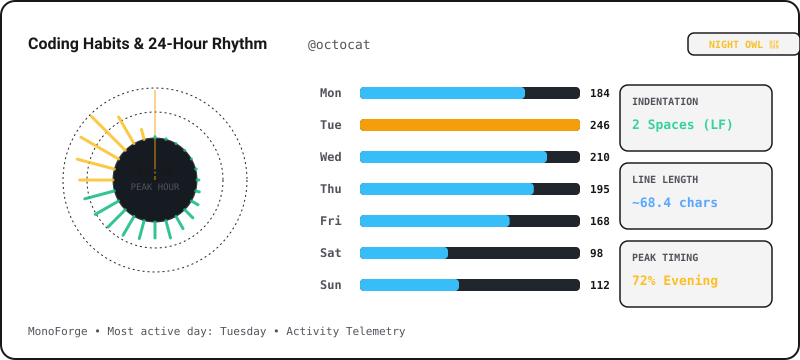
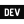
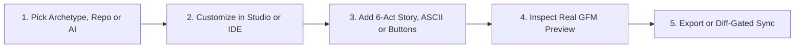
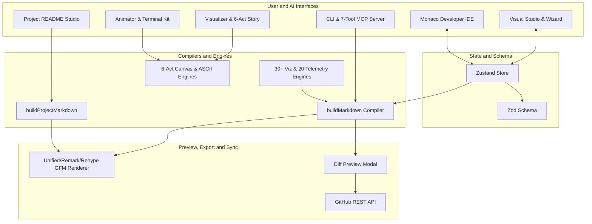

<div align="center" id="top">

  <!-- MonoForge Official Geometric Monkey Logo (Click to launch Studio) -->
  <a href="https://monoforge-studio.vercel.app/en">
    
  </a>

  <br />
  <br />

  <h1>◈ MONOFORGE ◈</h1>

  <p>
    <strong>Forge iconic, interactive GitHub Profile &amp; Project READMEs with a Visual Studio, Monaco IDE split-preview, real GFM rendering, 6-Act Canvas Contribution Story, Monochrome ASCII Portrait &amp; Terminal Kit, 60fps Camo-safe animated SVGs, 30+ live telemetry visuals, and Claude/MCP automation.</strong>
  </p>

  <p>
    <em>100% Free, Local-First, Open Source &amp; Zero-Config Ready for Claude, Cursor, and AI Agents.</em>
  </p>

  <!-- Repository Status & Community Badges -->
  <p>
    <a href="https://github.com/yuvraj-thakur-exe/MONOFORGE/actions/workflows/ci.yml">
      
    </a>
    <a href="https://monoforge-studio.vercel.app/en">
      
    </a>
    <a href="https://github.com/yuvraj-thakur-exe/MONOFORGE/blob/main/LICENSE.md">
      
    </a>
    <a href="https://github.com/yuvraj-thakur-exe/MONOFORGE/stargazers">
      
    </a>
    <a href="https://github.com/yuvraj-thakur-exe/MONOFORGE/network/members">
      
    </a>
    <a href="https://github.com/yuvraj-thakur-exe/MONOFORGE/issues">
      
    </a>
  </p>

  <!-- Interactive Quick-Action Studio Buttons -->
  <p>
    <a href="https://monoforge-studio.vercel.app/en">
      
    </a>
    <a href="https://monoforge-studio.vercel.app/en/developer">
      
    </a>
    <a href="https://monoforge-studio.vercel.app/en/visualizer">
      
    </a>
    <a href="https://monoforge-studio.vercel.app/en/animator">
      
    </a>
    <a href="https://monoforge-studio.vercel.app/en/project-readme">
      
    </a>
    <a href="https://monoforge-studio.vercel.app/en/templates">
      
    </a>
    <a href="https://monoforge-studio.vercel.app/en/assets">
      
    </a>
    <a href="https://github.com/yuvraj-thakur-exe/MONOFORGE">
      
    </a>
  </p>

</div>

---

<!-- INTERACTIVE ANIMATED HERO WORKSTATION -->
<p align="center">
  <a href="https://monoforge-studio.vercel.app/en/templates?template=wow-3d-city-cat">
    
  </a>
  <br />
  
</p>

> [!TIP]
> **Click any banner, animated SVG, telemetry chart, or action button in this README** to jump straight into the corresponding live MonoForge studio and customize it with your own GitHub handle in seconds.

---

## ▸ 30-Second Quickstart (Interactive Studio, CLI, or Claude/MCP)

Pick your fastest path to a customized, interactive GitHub Profile or Repository `README.md`:

- **◈ 1-Click Visual Studio**: Open [monoforge-studio.vercel.app/en](https://monoforge-studio.vercel.app/en) or [Templates Gallery](https://monoforge-studio.vercel.app/en/templates) to inspect **330 Profile Archetypes** rendered through the real GFM Markdown pipeline.
- **▸ AI Assistant Plug-and-Play (Claude / Cursor / Antigravity)**: MonoForge ships with root [`.mcp.json`](.mcp.json), [`.claude/commands/`](.claude/commands/forge-readme.md), [`CLAUDE.md`](CLAUDE.md), and **7 MCP tools** — ask Claude or Cursor `/forge-readme` right inside this workspace!
- **✦ Interactive 6-Act Story & 30+ Visualizations**: Launch [Visualizer Studio](https://monoforge-studio.vercel.app/en/visualizer) for pure time-based Canvas contribution animations and live Camo-safe SVGs.
- **⟐ Terminal Profile Kit & Monochrome ASCII Portrait**: Launch [Animator Studio → Terminal Kit](https://monoforge-studio.vercel.app/en/animator) to convert any photo into a self-typing ASCII portrait SVG paired with a `whoami` card and diagonal heatmap.
- **⌘ Project README Inspector**: Paste any `https://github.com/owner/repo` at [Project README Studio](https://monoforge-studio.vercel.app/en/project-readme) to auto-detect `package.json`, `Cargo.toml`, `go.mod`, `pyproject.toml`, `Dockerfile`, and `.env.example`.
- **1-Command Interactive Builder / CLI** *(zero install, runs directly from GitHub)*:

```bash
# Build a customized, interactive README with animated SVGs, buttons, <details> accordions & live telemetry:
npx github:yuvraj-thakur-exe/MONOFORGE build -u <your-github-username> --name "Your Name" --role "Full-Stack Engineer" --theme emerald

# Or forge directly from any of 40 built-in archetypes and stream to stdout:
npx github:yuvraj-thakur-exe/MONOFORGE generate -u <your-github-username> -a wow-3d-city-cat -o - > README.md
```

<details>
  <summary><b>◈ Interactive Guide: Use MonoForge with Claude Code, Claude Desktop, Cursor &amp; Antigravity (7 MCP Tools)</b> <em>(click to expand)</em></summary>

<br />

MonoForge is pre-configured so AI coding assistants immediately understand every SVG asset, icon, archetype, and telemetry API in this repo:

1. **Zero-Config Discovery**: Root [`.mcp.json`](.mcp.json) and [`.cursor/mcp.json`](.cursor/mcp.json) register `node ./bin/monoforge.js mcp` automatically.
2. **Built-In Claude Code Slash Commands**:
   - `/forge-readme <username / goal>` — defined in [`.claude/commands/forge-readme.md`](.claude/commands/forge-readme.md)
   - `/forge-project-readme <repo / path>` — defined in [`.claude/commands/forge-project-readme.md`](.claude/commands/forge-project-readme.md)
3. **7 Exposed MCP Tools (`bin/monoforge.js mcp`)**:
   - `build_interactive_readme` — builds a full interactive README with animated SVGs, clickable Studio & social buttons, `diagonal-heatmap` + `whoami`, `<details>` deep dives, Snake arcade, and Mermaid flowcharts
   - `generate_profile_readme` — renders any of the **40 CLI archetypes** (`--archetype`)
   - `list_archetypes` — lists all 40 CLI archetypes by category
   - `list_visualizations` — returns all live `/api/telemetry/svg` plugins and 7 themes (`emerald`, `matrix`, `cyberpunk`, `tokyonight`, `amber`, `slate`, `ocean`)
   - `search_assets` — searches **53 core SVG visuals** and **47 verified social icons** inside `public/assets/`
   - `inspect_asset` — verifies exact `viewBox`, dimensions, bytes, Camo safety (`0 <script>`, `0 <foreignObject>`), and clickable HTML snippets
   - `generate_telemetry_embed` — creates clickable Studio-linked SVG embeds
4. **Copy-Ready AI Prompts** *(paste straight into Claude, Cursor, or Antigravity)*:
   ```text
   Use MonoForge MCP tools (`search_assets`, `list_visualizations`, `build_interactive_readme`)
   to build me an interactive GitHub Profile README for `@YOUR_HANDLE` with an animated mascot,
   clickable action buttons, diagonal contribution heatmap, whoami terminal card, <details>
   architecture Mermaid diagram, and my TypeScript/Rust tech stack.
   ```

</details>

### Why MonoForge?

| Capability | MonoForge | Legacy README Generators |
| :--- | :--- | :--- |
| **Claude & Multi-AI MCP Ready** | Root `.mcp.json`, `.claude/commands/*`, `CLAUDE.md`, `/api/schema`, `/llms.txt` & **7 live MCP tools** | Manual prompt copying with no native MCP tools |
| **Interactive GitHub Elements** | Clickable Studio CTA buttons, verified icon bars, `<details>` accordions, clickable telemetry cards & Mermaid diagrams | Static plain Markdown walls of text |
| **Real GFM Markdown Previews** | Every template card & modal renders `buildMarkdown(config)` via `unified`/`remark`/`rehype` — zero fake dashboards | Static screenshots or invented mock analytics cards |
| **Camo-Safe 60fps SVGs** | Pure CSS `@keyframes`, zero `<script>`, zero `<foreignObject>`, `prefers-reduced-motion` | Static images or fragile external embeds |
| **6-Act Contribution Story** | Pure `draw(ctx, w, h, t)` Canvas engine: Diagonal Grid, `sqrt` 3D Skyline, Weekly Sparkline, Year Ring, Streak Tracer & Terminal | Static green boxes or heavy 3D libraries |
| **Terminal Profile Kit & ASCII** | Browser photo-to-ASCII monochrome SVG (`rowWipe`), Neofetch `whoami` card, diagonal heatmap + self-hosted GitHub Action kit | Manual terminal scripts or unstyled text |
| **Live GitHub Telemetry API** | **30+ SVG visualizations** & **20 telemetry presets** with honest provenance labels (`LIVE GITHUB` / `SAMPLE DATA` / `DATA UNAVAILABLE`) | Hardcoded counters or broken third-party cards |
| **Project README Studio** | Real GitHub repository inspector (`package.json`, `Cargo.toml`, `go.mod`, `Dockerfile`, `.env.example`), 9 studio tabs & Mermaid presets | Profile-only templates with no repo introspection |
| **Archetype & Asset Ecosystem** | **330 Profile Archetypes**, **40 CLI Archetypes**, **53 Core Vector Assets**, **47 Verified Social Icons** | Small handful of generic layouts |
| **Confirmation-Gated Sync** | Side-by-side remote diff preview + explicit per-item confirmation before any store or repo write | Blind overwrite or manual copy-paste |

<div align="center">
  <p>
    <strong>⭐ If MonoForge elevated your GitHub profile, <a href="https://github.com/yuvraj-thakur-exe/MONOFORGE">star the repository on GitHub</a> to support open-source development!</strong>
  </p>
</div>

---

## Table of Contents

- [Previews and Interactive Galleries](#previews-and-interactive-galleries)
- [Project Overview](#project-overview)
- [Features](#features)
  - [1. Visual Studio & Real GFM Markdown Rendering](#1-visual-studio--real-gfm-markdown-rendering)
  - [2. Developer Raw Mode IDE (`/developer`)](#2-developer-raw-mode-ide-developer)
  - [3. Telemetry & Visualization Engine (`/telemetry` & `/visualizer`)](#3-telemetry--visualization-engine-telemetry--visualizer)
  - [4. 6-Act Contribution Story (`/visualizer` → `6-Act Story`)](#4-6-act-contribution-story-visualizer--6-act-story)
  - [5. SVG Animator Studio & Terminal Profile Kit (`/animator`)](#5-svg-animator-studio--terminal-profile-kit-animator)
  - [6. Project README Studio (`/project-readme`)](#6-project-readme-studio-project-readme)
  - [7. Asset & Sticker Vault + Command Palette (`/assets` & `Cmd+K`)](#7-asset--sticker-vault--command-palette-assets--cmdk)
  - [8. 330 Curated Profile Archetypes (`/templates`)](#8-330-curated-profile-archetypes-templates)
  - [9. Confirmation-Gated GitHub Synchronization](#9-confirmation-gated-github-synchronization)
  - [10. Resume Import & Web Enrichment](#10-resume-import--web-enrichment)
  - [11. 60fps Camo Vector & Mascot System](#11-60fps-camo-vector--mascot-system)
  - [12. CLI, 7-Tool MCP Server & Multi-AI Integration](#12-cli-7-tool-mcp-server--multi-ai-integration)
- [Tech Stack](#tech-stack)
- [Getting Started & Installation](#getting-started)
- [Environment Configuration](#environment-configuration)
- [Usage Guide](#usage-guide)
- [CLI & MCP Documentation](#cli-documentation)
- [Project Architecture](#project-architecture)
- [Scripts and Commands](#scripts-and-commands)
- [Roadmap](#roadmap)
- [Contributing](#contributing)
- [License & Acknowledgements](#license)

---

## Previews and Interactive Galleries

Every card below links directly to its interactive MonoForge Studio — click any preview to customize it live:

<table>
  <tr>
    <th width="50%" align="center">Bento Signal Dashboard</th>
    <th width="50%" align="center">3D Isometric Commit City</th>
  </tr>
  <tr>
    <td align="center">
      <a href="https://monoforge-studio.vercel.app/en/templates?template=bento-signal-dashboard">
        
      </a>
      <br />
      <em>Live profile metrics: stars, commits, polyglot distribution, and repository signals.</em>
    </td>
    <td align="center">
      <a href="https://monoforge-studio.vercel.app/en/templates?template=wow-3d-city-cat">
        
      </a>
      <br />
      <em>3D isometric contribution city paired with retro developer avatar and tech stack badges.</em>
    </td>
  </tr>
  <tr>
    <th align="center">Telemetry Habits &amp; Velocity Radar</th>
    <th align="center">Tactile Sticker Vault</th>
  </tr>
  <tr>
    <td align="center">
      <a href="https://monoforge-studio.vercel.app/en/telemetry">
        
      </a>
      <br />
      <em>Circadian rhythm commit velocity, active working hours, and pace tracking.</em>
    </td>
    <td align="center">
      <a href="https://monoforge-studio.vercel.app/en/assets">
        
      </a>
      <br />
      <em>Camo-compliant developer badges, status indicators, and sticker elements.</em>
    </td>
  </tr>
  <tr>
    <th align="center">Diagonal-Reveal Contribution Heatmap (Live SVG)</th>
    <th align="center">Neofetch Whoami Info Card (Live SVG)</th>
  </tr>
  <tr>
    <td align="center">
      <a href="https://monoforge-studio.vercel.app/en/visualizer?user=yuvraj-thakur-exe&viz=diagonal-heatmap&theme=emerald">
        
      </a>
      <br />
      <em>53x7 CSS staggered diagonal sweep heatmap (<code>plugin=diagonal-heatmap</code>) with streak and best-day footer.</em>
    </td>
    <td align="center">
      <a href="https://monoforge-studio.vercel.app/en/animator">
        
      </a>
      <br />
      <em>Staggered terminal profile card (<code>plugin=whoami</code>) pairable side-by-side with your monochrome ASCII portrait.</em>
    </td>
  </tr>
</table>

<details>
  <summary><b>▸ Expand: Animated SVGs, Vector Mascots &amp; Retro Arcade Sprites Gallery</b> <em>(60fps GitHub Camo-Safe — click any SVG to edit)</em></summary>

<br />

<table>
  <tr>
    <th width="25%" align="center">Roaming Cyber Bot</th>
    <th width="25%" align="center">Developer Desk</th>
    <th width="25%" align="center">Coding Unicorn</th>
    <th width="25%" align="center">Celebratory Owl</th>
  </tr>
  <tr>
    <td align="center">
      <a href="https://monoforge-studio.vercel.app/en/animator">
        
      </a>
    </td>
    <td align="center">
      <a href="https://monoforge-studio.vercel.app/en/animator">
        
      </a>
    </td>
    <td align="center">
      <a href="https://monoforge-studio.vercel.app/en/animator">
        
      </a>
    </td>
    <td align="center">
      <a href="https://monoforge-studio.vercel.app/en/animator">
        
      </a>
    </td>
  </tr>
  <tr>
    <th colspan="2" align="center">Contribution Grid Snake (<code>snake.svg</code>)</th>
    <th colspan="2" align="center">Animated Retro Terminal (<code>terminal_animated.svg</code>)</th>
  </tr>
  <tr>
    <td colspan="2" align="center">
      <a href="https://monoforge-studio.vercel.app/en/visualizer?viz=contribution-snake">
        
      </a>
    </td>
    <td colspan="2" align="center">
      <a href="https://monoforge-studio.vercel.app/en/visualizer?viz=developer-terminal">
        
      </a>
    </td>
  </tr>
</table>

</details>

<details>
  <summary><b>✦ Expand: Live Telemetry Visuals &amp; 6-Act Contribution Story Gallery</b> <em>(click any chart to switch theme &amp; username live)</em></summary>

<br />

<table>
  <tr>
    <th width="50%" align="center">3D Isometric Commit City (<code>plugin=city</code>)</th>
    <th width="50%" align="center">Harmonic Language River (<code>plugin=languageriver</code>)</th>
  </tr>
  <tr>
    <td align="center">
      <a href="https://monoforge-studio.vercel.app/en/visualizer?user=yuvraj-thakur-exe&viz=commit-city&theme=emerald">
        
      </a>
    </td>
    <td align="center">
      <a href="https://monoforge-studio.vercel.app/en/visualizer?user=yuvraj-thakur-exe&viz=language-river&theme=ocean">
        
      </a>
    </td>
  </tr>
  <tr>
    <th width="50%" align="center">Engineering Radar (<code>plugin=radar</code>)</th>
    <th width="50%" align="center">Coding Pulse EKG (<code>plugin=pulse</code>)</th>
  </tr>
  <tr>
    <td align="center">
      <a href="https://monoforge-studio.vercel.app/en/visualizer?user=yuvraj-thakur-exe&viz=engineering-radar&theme=amber">
        
      </a>
    </td>
    <td align="center">
      <a href="https://monoforge-studio.vercel.app/en/visualizer?user=yuvraj-thakur-exe&viz=coding-pulse&theme=matrix">
        
      </a>
    </td>
  </tr>
</table>

</details>

<details>
  <summary><b>⟐ Expand: Verified Social Icons, Symbols, Clickable Buttons &amp; GFM Components Showcase</b> <em>(click to expand)</em></summary>

<br />

MonoForge provides **47 official vector social icons** under `public/assets/icons/social/<platform>/default.svg`, crisp geometric symbols (`◈`, `▸`, `✦`, `⟐`, `⌘`, `⊞`), clickable CTA pill buttons, and native Mermaid diagrams that render natively on GitHub:

<p align="center">
  <a href="https://monoforge-studio.vercel.app/en/assets" title="GitHub">
    
  </a> &nbsp;
  <a href="https://monoforge-studio.vercel.app/en/assets" title="LinkedIn">
    
  </a> &nbsp;
  <a href="https://monoforge-studio.vercel.app/en/assets" title="X">
    
  </a> &nbsp;
  <a href="https://monoforge-studio.vercel.app/en/assets" title="Discord">
    
  </a> &nbsp;
  <a href="https://monoforge-studio.vercel.app/en/assets" title="YouTube">
    
  </a> &nbsp;
  <a href="https://monoforge-studio.vercel.app/en/assets" title="LeetCode">
    
  </a> &nbsp;
  <a href="https://monoforge-studio.vercel.app/en/assets" title="Dev.to">
    
  </a> &nbsp;
  <a href="https://monoforge-studio.vercel.app/en/assets" title="Hashnode">
    
  </a>
</p>

```markdown
<!-- Clickable Action Button + Verified Symbol Pattern -->
<a href="https://monoforge-studio.vercel.app/en/developer?user=YOUR_HANDLE">
  
</a>
```

</details>

---

## Project Overview

### What is MonoForge?

**MonoForge** is an open-source GitHub profile and repository README engineering platform. It unites a guided Visual Studio, a Monaco-powered raw JSON IDE, **330 profile archetypes**, **22 modular plugins**, **30+ SVG telemetry visualizations** paired with a **6-Act pure Canvas contribution story**, a **Terminal Profile Kit** with photo-to-ASCII portrait conversion, **20 telemetry presets**, a **9-tab Project README Studio**, **47 verified social icons**, a **7-tool MCP server** for Claude and Cursor, and a 60fps GPU-accelerated SVG motion engine.

### What Problem Does It Solve?

Traditional GitHub profiles rely on brittle copy-pasted HTML tables, fake analytics cards, or rate-limited third-party badge servers:
- Fake template cards mislead users when they show invented statistics instead of the actual compiled README.
- Static generators rarely include real interactive links, expandable `<details>` specs, animated Camo-safe SVGs, or AI/MCP workflows.
- Third-party badge servers slow down page loads or break under GitHub's **Camo CDN proxy**.
- Repository READMEs are often left out of profile generators despite needing real manifest detection (`package.json`, `pyproject.toml`, `Cargo.toml`, `go.mod`, `Dockerfile`).

### Why Developers & AI Agents Choose MonoForge

1. **Pure Function Markdown Generation**: All profile output is produced by `buildMarkdown(config)`, a deterministic, side-effect-free compiler covered by automated unit tests.
2. **Real Rendered Previews**: Every template card and full modal renders `buildMarkdown(template.config)` through `ReadmeMarkdownRenderer` (`unified` + `remark-gfm` + `rehype-raw` + `rehype-sanitize` + `html-react-parser`).
3. **AI-Native by Design**: Root `.mcp.json`, `.claude/commands/*`, `CLAUDE.md`, `AGENTS.md`, `CURSOR.md`, `/api/schema`, `/api/agent/skill`, `/llms.txt`, and `bin/monoforge.js mcp` allow Claude, Cursor, Antigravity, and other agents to search SVGs, inspect Camo compliance, and compose interactive READMEs programmatically.
4. **Honest Telemetry Provenance**: `/api/telemetry/svg` stamps every dynamic SVG with its true source status (`LIVE GITHUB`, `SAMPLE DATA`, `PARTIAL DATA`, or `DATA UNAVAILABLE`) — never silently faking offline metrics.
5. **Strict Confirmation Gates**: Neither parsed resume items nor remote GitHub commits are ever applied without explicit per-item review and side-by-side diff confirmation.

---

## Features

### 1. Visual Studio & Real GFM Markdown Rendering
- **True Preview Pipeline**: `TemplateReadmePreview.tsx` compiles any supplied `ReadmeConfig` via `buildMarkdown(config)` without mutating the global Zustand store, passing output through `ReadmeMarkdownRenderer.tsx`.
- **Guided Studio & Wizard (`/wizard`)**: Assemble your profile header, bio, **47 verified social icons**, tech stack, and dynamic telemetry blocks with drag/reorder controls and visibility toggles.
- **Responsive Viewport Inspection**: Preview profiles seamlessly across desktop, tablet, Cyber CRT terminal, and mobile viewports.

### 2. Developer Raw Mode IDE (`/developer`)
- **Split-Screen Monaco Editor**: Full bidirectional sync with the application's central Zustand store (`website/src/store/useReadmeStore.ts`).
- **Zod Schema Validation**: Real-time syntax and AST schema diagnostics backed by `/api/schema` and `website/src/lib/plugins/types.ts`.
- **22 Modular Plugins (`PluginPanel.tsx`)**: Registry-driven plugin picker covering banners, stats, 3D calendars, trophy racks, contribution snakes, and custom Camo-safe HTML blocks.
- **One-Click Optimize & Health Score**: Audit readability, heading structure, badge consistency, and export to Markdown, PNG (`html-to-image`), JSON, or base64 share URLs.

### 3. Telemetry & Visualization Engine (`/telemetry` & `/visualizer`)
Powered by **30 registered visualization engines**, **35 SVG generator functions**, and **20 telemetry catalog presets** exposed via `/api/telemetry/svg`:
- **Live Data Hydration**: Fetches real public GitHub accounts and contribution calendars via `/api/telemetry/contributions?user=<username>` and `website/src/lib/visualizations/data-engine.ts`.
- **7 Built-In Palettes**: `emerald`, `matrix`, `cyberpunk`, `tokyonight`, `amber`, `slate`, `ocean`.
- **Signature Visualization Endpoints (`/api/telemetry/svg?plugin=<id>&user=<username>&theme=<theme>`)**:
  - **Diagonal Heatmap**: `plugin=diagonal-heatmap` (aliases: `diagonalheatmap`, `contrib-heatmap`, `contribheatmap`)
  - **Neofetch Whoami Card**: `plugin=whoami` (aliases: `info-card`, `infocard`)
  - **3D Isometric Skyline & Calendar**: `plugin=city` (`commitcity`, `skyline`) & `plugin=isocalendar` (`calendar`, `iso`)
  - **Harmonic Language River**: `plugin=languageriver` (`polyglot`) & `plugin=river` (`commitriver`)
  - **Engineering Radar & Blueprint**: `plugin=radar` (`engineeringradar`) & `plugin=blueprint` (`schematic`)
  - **Year Clock & Coding Pulse**: `plugin=yearclock` (`radial`) & `plugin=pulse` (`ekg`)
  - **Developer DNA, Galaxy & Solar System**: `plugin=dna`, `plugin=galaxy`, `plugin=solarsystem`
  - **Fastfetch Terminal & Synthwave Bento**: `plugin=neofetch` (`fastfetch`) & `plugin=synthwave` (`outrun`)
  - **2D Heatmap, Velocity, LeetCode, Music & PageSpeed**: `plugin=heatmap`, `plugin=velocity`, `plugin=leetcode`, `plugin=music`, `plugin=pagespeed`
- **Multiple Studio Modes**: Switch inside `/visualizer` between **Interactive Canvas**, **Animated SVG (Camo-Safe)**, **6-Act Story**, and **Compiled README Preview**, or browse the **Telemetry Arsenal** (`/telemetry`) for GitHub Actions workflow generation.

### 4. 6-Act Contribution Story (`/visualizer` → `6-Act Story`)
Built on `website/src/lib/visualizations/contribution-story.ts` and `ContributionStoryCanvases.tsx` — six pure time-based `draw(ctx, w, h, t)` HTML5 Canvas animations with zero runtime charting dependencies:
1. **Act 01 — The Grid**: 53x7 diagonal wave drop-in with overshoot easing, bright green flash settling into GitHub's five official greens (`#ebedf0`–`#216e39`), scaled running count-up landing accurately on `totalContributions`, and live square hover tooltips.
2. **Act 02 — Skyline**: Three-face 3D oblique isometric extrusion drawn back-to-front using `sqrt(count)` height scaling (so extreme sprint days don't flatten the rest of the year) plus a leader callout to your peak day.
3. **Act 03 — Week by Week**: Animated 53-week sparkline with a riding glowing dot that pours into 7-day stacked bar columns.
4. **Act 04 — Round the Year**: Radial chronometer with 7 concentric weekday rings and 53 week spokes revealed by a sweeping radar hand.
5. **Act 05 — The Streak**: Active contribution streak traced day-by-day with a glowing path trail and `last day off` break marker.
6. **Act 06 — In the Terminal**: Simulated typing prompt (`./year-in-code.sh`) that resolves from scrambling glyphs into density ASCII symbols (`. : + # @`).
- **Performance & Accessibility**: Uses `IntersectionObserver` (40% threshold, renders only while visible on screen), per-card Replay, global **Replay All 6 Acts**, Dark/Light GitHub palette toggle, and `t = Infinity` instant final-frame rendering under `prefers-reduced-motion: reduce`.

### 5. SVG Animator Studio & Terminal Profile Kit (`/animator`)
A 5-tab vector animation suite (`Layers`, `Presets`, `UI Motion`, `Timeline`, `Terminal Kit`) powered by `AnimatorStudio.tsx`, `AnimationTimeline.tsx`, and `TerminalProfileKit.tsx`:
- **Monochrome ASCII Portrait Converter (`ascii-portrait.ts`)**: Upload any portrait or avatar in-browser, adjust **Contrast** and **White Cutoff Threshold**, preview the 12-level `ASCII_DENSITY_RAMP` silhouette (`imageDataToAsciiGrid`), and export a Camo-safe SVG using staggered CSS `rowWipe` animations that play once and freeze cleanly.
- **Whoami Info Card & Diagonal Heatmap**: Customize `Now`, `Prev`, `Stack`, and `Highlights` fields live and export matching Camo-safe Markdown pairs (`` beside ``).
- **Self-Hosted Daily Refresh Kit**: One-click copy/download of `scripts/fetch-github.mjs` (fetches 53x7 contribution counts and levels via GitHub GraphQL into a compact ~3 KB `data/github.json`) and a scheduled GitHub Actions workflow YAML to refresh your SVGs automatically.
- **Vector Character & Hero Layer Editor**: Customize keyframe timelines, animated characters, cyber frames, Matrix rain, fire embers, and glitch/typing headlines with Camo validator checks (`validator.ts`).

### 6. Project README Studio (`/project-readme`)
A dedicated **9-tab technical documentation studio** (`Meta`, `Badges`, `Features`, `Architecture`, `Stack`, `Install`, `Env Vars`, `Roadmap`, `Sections`) at `/en/project-readme`:
- **Live GitHub Repo Inspector (`/api/project-readme/inspect`)**: Paste any `https://github.com/owner/repo` or `owner/repo` to fetch metadata and automatically parse `package.json`, `pyproject.toml`, `Cargo.toml`, `go.mod`, `Dockerfile`, and `.env.example` into a structured config.
- **Starter Presets & Architecture Diagrams**: Start from 6 domain blueprints (`Developer Tool`, `SaaS Platform`, `OSS Library`, `CLI Binary`, `AI / LLM Agent`, `Full-Stack Web`) with built-in Mermaid flowchart presets (`flowchart LR` / `flowchart TD`).
- **GFM & Raw Preview**: Switch between rendered GitHub Flavored Markdown and raw `.md` source across desktop/tablet/mobile viewports with instant copy or `README.md` download.

### 7. Asset & Sticker Vault + Command Palette (`/assets` & `Cmd+K`)
- **Unified Asset Vault (`/en/assets`)**: Browse and filter MonoForge's **53 protected core SVGs** and community marketplace stickers, verify Camo compliance, copy `raw.githubusercontent.com` URLs or Markdown snippets, or append items straight into your active profile store.
- **Global Command Palette (`CommandPalette.tsx`)**: Press `Cmd+K` / `Ctrl+K` anywhere in MonoForge to jump across studios, switch dark/light themes, open Profile Intelligence, open the Diagnostics HUD (`Ctrl+Shift+D`), launch Resume Upload, or trigger GitHub Sync.

### 8. 330 Curated Profile Archetypes (`/templates`)
Choose from **330 profile archetypes** in the Web Studio (`TEMPLATES` in `catalog.ts`) plus **40 standalone CLI archetypes** in `bin/monoforge.js`:
- **Authentic Previews (`TemplateReadmePreview.tsx`)**: View compiled Markdown directly in every gallery card, full modal, and side-by-side `TemplateCompareModal`.
- **Deep-Linking**: Share or launch any archetype via `?template=<id>` or hydrate custom configurations via `?config=<base64>`.

### 9. Confirmation-Gated GitHub Synchronization
- Authenticated GitHub workflow via REST API (`website/src/lib/github/sync.ts`).
- Fetches real remote `README.md` content to compute a side-by-side diff preview (`website/src/components/sync/DiffPreview.tsx`).
- **Strict Invariant**: Zero writes occur without explicit "Confirm & push" verification by the user.

### 10. Resume Import & Web Enrichment
- Server-side extraction from `.pdf` and `.docx` resumes via `pdf-parse` and `mammoth` (`/api/enrichment/resume`).
- Enrichment suggestions for missing social accounts, technologies, and project links.
- **Confirmation-Gated**: Discovered data is never written to the profile store without per-item user approval (`ConfirmGate.tsx`).

### 11. 60fps Camo Vector & Mascot System
- **Engineered for GitHub Camo**: Strict adherence to GitHub sanitization rules — zero `<script>`, zero `<foreignObject>`, system font fallbacks, and GPU-accelerated CSS `@keyframes`.
- **Animated Characters**: Cyber Bot, Pixel Developer Desk, Ninja Coder, Builder Crafter, Wizard Mage, Coding Unicorn, Octocat Coffee, and Celebratory Owl.
- **Accessibility**: Built-in `@media (prefers-reduced-motion: reduce)` static fallbacks across all animated SVGs.

### 12. CLI, 7-Tool MCP Server & Multi-AI Integration
- **Zero-Dependency CLI (`bin/monoforge.js`)**: `build` (interactive README generator), `generate` (40 archetypes), `list`, `visualizations`, `skill-install`, and `mcp`.
- **7-Tool MCP Server (`.mcp.json` & `.cursor/mcp.json`)**: `build_interactive_readme`, `generate_profile_readme`, `list_archetypes`, `list_visualizations`, `search_assets`, `inspect_asset`, and `generate_telemetry_embed`.
- **Claude Code Commands**: `.claude/commands/forge-readme.md` (`/forge-readme`) & `.claude/commands/forge-project-readme.md` (`/forge-project-readme`).
- **Agent & Discovery Endpoints**: `/api/schema`, `/api/agent/skill`, `/llms.txt`, `/llms-full.txt`, and `/.well-known/ai-plugin.json`.

---

## Tech Stack

| Technology | Purpose | Implementation in Project |
| :--- | :--- | :--- |
| **Next.js 16** | Application Framework | App Router, Server Components, Turbopack, and API route handlers (`/api/telemetry/*`, `/api/project-readme/*`). |
| **React 19** | User Interface | Concurrent rendering, interactive studio state, and pure Canvas animation hooks. |
| **TypeScript** | Type Safety | Strict compiler configuration (`website/tsconfig.json`) across models, plugins, generators, and UI. |
| **Zustand 5** | State Management | Single profile source of truth (`website/src/store/useReadmeStore.ts`) + Project README store (`useProjectReadmeStore.ts`). |
| **Zod 4** | Schema Validation | AST validation for profile configurations, resume payloads, and plugin options. |
| **unified / remark / rehype** | Markdown Pipeline | Real GFM rendering via `remark-parse`, `remark-gfm`, `remark-rehype`, `rehype-raw`, `rehype-sanitize`, and `html-react-parser`. |
| **Monaco Editor** | Raw Mode IDE | Split-screen JSON editing with live schema diagnostic markers (`@monaco-editor/react`). |
| **Tailwind CSS 4** | Styling & Design Tokens | Utility-first CSS using refined slate palettes, amber accents, GitHub emerald, and `tailwind-variants`. |
| **Radix UI & cmdk** | Headless Primitives | Accessible dialogs, dropdowns, switches, and the global `Cmd+K` Command Palette. |
| **Framer Motion & Sonner** | Motion & Feedback | Reduced-motion-aware transitions (`motion/` wrappers), `canvas-confetti`, and crisp toast alerts. |
| **GitHub REST & GraphQL** | GitHub Integration | Repo inspection, contribution fetching, remote diff preview, and confirmation-gated commits (`octokit`). |
| **Biome** | Code Quality | High-speed linting and formatting (`biome check website/src`). |
| **Vitest 4** | Unit Testing | Fast test runner covering **182 test files (880+ unit tests)** in `website/src/`. |
| **Playwright** | E2E Testing | Cross-browser end-to-end verification for studio flows and exports. |

---

## Getting Started

### Prerequisites

Ensure you have the following installed on your machine:
- **Node.js**: `v20.x` or later (LTS recommended)
- **pnpm**: `v10.x` (`10.12.4` via Corepack)

```bash
corepack enable
corepack prepare pnpm@10.12.4 --activate
```

---

## Installation

### Fast 1-Line Local Studio Setup

- **macOS / Linux**:
  ```bash
  curl -fsSL https://raw.githubusercontent.com/yuvraj-thakur-exe/MONOFORGE/main/install.sh | bash
  ```
- **Windows (PowerShell)**:
  ```powershell
  iwr -useb https://raw.githubusercontent.com/yuvraj-thakur-exe/MONOFORGE/main/install.ps1 | iex
  ```

### Manual Setup

1. **Clone the repository:**
   ```bash
   git clone https://github.com/yuvraj-thakur-exe/MONOFORGE.git
   cd MONOFORGE
   ```

2. **Install project dependencies:**
   ```bash
   pnpm install
   ```

3. **Configure environment variables (optional):**
   ```bash
   cp .env.example .env.local
   ```

4. **Start the local development server:**
   ```bash
   pnpm dev
   ```

5. **Open your browser:**
   - **Main Studio**: [http://localhost:3000/en](http://localhost:3000/en)
   - **Visual Wizard**: [http://localhost:3000/en/wizard](http://localhost:3000/en/wizard)
   - **Developer IDE**: [http://localhost:3000/en/developer](http://localhost:3000/en/developer)
   - **Archetype Gallery**: [http://localhost:3000/en/templates](http://localhost:3000/en/templates)
   - **SVG Visualizer & 6-Act Story**: [http://localhost:3000/en/visualizer](http://localhost:3000/en/visualizer)
   - **Animator & Terminal Kit**: [http://localhost:3000/en/animator](http://localhost:3000/en/animator)
   - **Project README Studio**: [http://localhost:3000/en/project-readme](http://localhost:3000/en/project-readme)
   - **Telemetry Arsenal**: [http://localhost:3000/en/telemetry](http://localhost:3000/en/telemetry)
   - **Asset & Sticker Vault**: [http://localhost:3000/en/assets](http://localhost:3000/en/assets)

---

## Environment Configuration

MonoForge runs locally without mandatory credentials. To enable authenticated GitHub push synchronization, higher API rate limits, or optional WakaTime metrics locally, configure `.env.local` from [`.env.example`](.env.example):

```env
# MonoForge Environment Configuration

# NextAuth / GitHub OAuth (Optional — for GitHub OAuth / local sync flows)
# Create a GitHub OAuth App at: https://github.com/settings/developers
GITHUB_ID=""
GITHUB_SECRET=""
NEXTAUTH_URL="http://localhost:3000"
NEXTAUTH_SECRET="your-generated-nextauth-secret-key"

# Optional: GitHub Personal Access Token for server-side repo inspection & GraphQL rate limits
GITHUB_TOKEN=""

# Optional: WakaTime Integration
WAKATIME_API_KEY=""

# Public Application URL
NEXT_PUBLIC_APP_URL="http://localhost:3000"
```

### Variable Details

| Variable | Requirement | Description |
| :--- | :---: | :--- |
| `GITHUB_ID` | Optional | GitHub OAuth Client ID for local OAuth configuration. |
| `GITHUB_SECRET` | Optional | GitHub OAuth Client Secret. |
| `NEXTAUTH_URL` | Optional | Canonical URL of the application (`http://localhost:3000` locally). |
| `NEXTAUTH_SECRET` | Optional | Secret string used to sign session cookies when OAuth is enabled. |
| `GITHUB_TOKEN` | Optional | Server token raising GitHub API limits for `/api/telemetry/svg` and `/api/project-readme/inspect`. |
| `WAKATIME_API_KEY` | Optional | API token used to fetch coding time telemetry from WakaTime. |
| `NEXT_PUBLIC_APP_URL` | Optional | Base URL for resolving canonical URLs, OpenGraph images, and sitemaps. |

---

## Usage Guide

Follow this workflow to engineer an interactive GitHub profile or project README:



1. **Select an Archetype, Resume, Repository, or AI Prompt**:
   - Browse **330 starter templates** rendered live at `/en/templates`, inspect any GitHub repo at `/en/project-readme`, or ask Claude `/forge-readme`.
2. **Customize in Studio, Wizard (`/en/wizard`), or Monaco IDE (`/en/developer`)**:
   - Edit sections visually or modify raw JSON directly in Monaco with live `/api/schema` Zod validation.
3. **Add Animated SVGs, 6-Act Story, Buttons & Terminal Kit Art**:
   - Embed Camo-safe endpoints (`diagonal-heatmap`, `whoami`, `city`, `isocalendar`, `radar`), add animated mascots (`roaming-bot.svg`, `coding-unicorn.svg`), or forge a monochrome ASCII portrait SVG (`/en/animator`).
4. **Inspect Live GFM & Multi-Device Previews**:
   - Verify rendered headings, tables, `<details>` accordions, buttons, and SVGs across Desktop, Tablet, Cyber CRT Terminal, and Mobile viewports.
5. **Export or Push to GitHub**:
   - **Option A (Instant Export)**: Copy production-ready Markdown, download `README.md`, or download your self-hosted Action + `fetch-github.mjs` kit.
   - **Option B (Direct GitHub Sync)**: Click **Sync to GitHub**, review the side-by-side remote diff preview, and confirm the commit.

---

## CLI Documentation

MonoForge includes a standalone command-line tool and MCP server (`bin/monoforge.js`) running on Node.js 18+ with zero external package dependencies.

### Execution

```bash
# Run directly from GitHub without cloning:
npx github:yuvraj-thakur-exe/MONOFORGE build --username <handle> --theme emerald

# Or locally inside a cloned repo:
node bin/monoforge.js build --username <handle> --theme emerald
```

### Available Commands

| Command | Description | Example |
| :--- | :--- | :--- |
| `build` | Forge an interactive README with animated SVGs, buttons, `<details>` panels, Mermaid & live telemetry | `node bin/monoforge.js build -u octocat --theme emerald` |
| `generate` | Forge from any of the **40 standalone CLI archetypes** | `npx github:yuvraj-thakur-exe/MONOFORGE generate -u octocat -a wow-3d-city-cat` |
| `list` | List all **40 standalone CLI archetypes** | `npx github:yuvraj-thakur-exe/MONOFORGE list` |
| `visualizations` | List all live `/api/telemetry/svg` visualization IDs and 7 themes | `node bin/monoforge.js visualizations` |
| `skill-install` | Install MonoForge as an AI Agent Skill (`.agents/skills/monoforge/`) | `npx github:yuvraj-thakur-exe/MONOFORGE skill-install` |
| `mcp` | Start Model Context Protocol (MCP) stdio server (7 tools) | `node bin/monoforge.js mcp` |

### Command Options

```text
OPTIONS:
  --username, -u    GitHub username (default: 'octocat')
  --archetype, -a   Archetype ID (default: 'wow-3d-city-cat')
  --output, -o      Output file path (default: 'README.md', use '-' for stdout)
  --name            Display name (default: auto-detected or persona name)
  --role            Developer headline or role
  --theme           Telemetry theme: emerald, matrix, cyberpunk, tokyonight, amber, slate, ocean
  --mascot          Animated SVG mascot: desk, bot, unicorn, owl, hud, terminal
  --interactive     Enable interactive builder inside generate command
  --help, -h        Show help message
```

---

## Project Architecture

### Architectural Invariants

MonoForge is governed by four strict architectural rules (see [`AGENTS.md`](AGENTS.md)):

1. **One Zustand Store (`website/src/store/useReadmeStore.ts`)**: Holds all profile state. Both the visual studio and `/developer` raw editor read and write to this single store (`website/src/stores/readme-store.ts` re-exports it for compatibility). Project README state lives cleanly in `website/src/store/useProjectReadmeStore.ts`.
2. **Pure `buildMarkdown(config)` Generator (`website/src/lib/buildMarkdown.ts`)**: A pure function with zero React dependencies and zero side effects. Any profile formatting change passes through this function and its Vitest suite.
3. **Registry-Driven Plugins (`website/src/lib/plugins/registry.ts`)**: All **22 plugins** are plain objects validated against the Zod schema in `website/src/lib/plugins/types.ts`. Adding a plugin requires zero changes to core wizard or editor logic.
4. **Mandatory Confirmation Gates**: Neither resume extraction nor remote GitHub commits can write to state or repositories without explicit user review.

### Architecture Data Flow



### Documentation Index

- [Claude & AI Agent Guide](CLAUDE.md) — MCP setup, `.claude/commands/`, active routes, and architecture invariants.
- [OSS Integration Map](docs/OSS-INTEGRATION-MAP.md) — Evaluated open-source libraries, licenses, and integration guidelines.
- [AI Agent Integration Architecture](docs/ai/README-AGENT-INTEGRATION.md) — 30+ signature visualizations, 6-Act Story, Terminal Kit, normalized identity model, and agent architecture.
- [README Output Compatibility & Security](docs/README-OUTPUT-COMPATIBILITY.md) — GitHub Camo SVG allowlist, reduced motion, and asset caps.
- [Agent Acceptance Tests](docs/README-AGENT-ACCEPTANCE-TESTS.md) — End-to-end verification scenarios for generated profiles and assets.
- [Online Documentation](https://monoforge-studio.vercel.app/en/docs) — Interactive guides, CLI references, and search.

### Directory Map

```text
MONOFORGE/
├── .agents/                      # Autonomous agent rules & skills (monoforge, readmeforge, visual-asset-builder, etc.)
├── .claude/commands/             # Claude Code slash commands (/forge-readme, /forge-project-readme)
├── .cursor/mcp.json              # Cursor MCP client configuration
├── .github/workflows/            # ci.yml (CI pipeline) & monoforge-telemetry.yml (scheduled SVG export)
├── .mcp.json                     # Root zero-config MCP server manifest for Claude Code & multi-AI clients
├── bin/
│   └── monoforge.js              # Zero-dep CLI, interactive builder, 40 archetypes & 7-tool MCP server
├── docs/                         # Architecture, compatibility, and AI agent documentation
├── public/assets/                # Canonical root SVGs (53 assets) and 47 social icon sets for raw URLs
├── scripts/                      # SVG export & manifest automation scripts
├── website/
│   ├── public/                   # Hosted app assets, robots.txt, llms.txt, llms-full.txt, .well-known/
│   └── src/
│       ├── app/                  # Next.js 16 App Router ([locale]/..., /developer, /templates, /visualizer, /animator, /project-readme, /assets, /telemetry, /wizard, /canvas, /docs, api/*)
│       ├── components/
│       │   ├── animator/         # AnimatorStudio, AnimationTimeline, TerminalProfileKit
│       │   ├── assets/           # AssetLibraryModal
│       │   ├── common/           # ReadmeMarkdownRenderer, GeometricLoader, MonoForgeLogo
│       │   ├── developer/        # Monaco raw editor, plugin panel, export bar, optimize modal
│       │   ├── enrichment/       # Resume upload and confirmation gates
│       │   ├── landing/          # TemplateGallery, TemplateReadmePreview, TemplateCompareModal
│       │   ├── navigation/       # TopNav & global Cmd+K CommandPalette
│       │   ├── project-readme/   # 9-tab ProjectReadmeStudio & repo inspector UI
│       │   ├── studio/           # Hero, bento showcases, health score, doctor & asset vault modals
│       │   ├── sync/             # GitHub diff preview and confirmation push modals
│       │   ├── visualizer/       # VisualizationStudio, CanvasVisualizer, ContributionStoryCanvases
│       │   └── wizard/           # Step-by-step guided profile builder
│       ├── content/docs/         # In-app MDX/Markdown documentation source
│       ├── lib/
│       │   ├── animator/         # Vector presets, timeline, validator & ascii-portrait.ts
│       │   ├── assets/           # Discovery, sanitizer, protection & manifest utilities
│       │   ├── buildMarkdown.ts  # Pure profile Markdown compiler (unit tested)
│       │   ├── forge-telemetry/  # 20 telemetry engine catalog presets & SVG builders
│       │   ├── github/           # GitHub REST sync & GraphQL contributions fetcher
│       │   ├── plugins/          # 22 modular plugins + Zod schema types
│       │   ├── project-readme/   # GitHub repo analyzer, templates & pure project Markdown compiler
│       │   ├── templates/        # 330 curated profile archetypes
│       │   └── visualizations/   # 30 visualization manifests, 35 SVG generators & 6-Act Story canvases
│       ├── store/                # useReadmeStore.ts & useProjectReadmeStore.ts
│       └── translations/         # i18n locale bundles (en.json, pt-BR.json)
├── vitest.config.ts              # Vitest test runner scoped to website/src/
└── package.json                  # Workspace scripts and dependencies
```

---

## Scripts and Commands

All verified scripts available in [`package.json`](package.json):

| Command | Description |
| :--- | :--- |
| `pnpm dev` | Starts the Next.js development server on `http://localhost:3000`. |
| `pnpm build` | Compiles an optimized production build and prerenders static routes. |
| `pnpm start` | Runs the compiled production server. |
| `pnpm lint` | Runs Biome checks across `website/src/`. |
| `pnpm format` | Formats source files in `website/src/` using Biome. |
| `pnpm format:check` | Verifies `website/src/` adheres to Biome formatting rules without writing changes. |
| `pnpm type-check` | Executes strict TypeScript type checking (`tsc -p website/tsconfig.json --noEmit`). |
| `pnpm test` | Runs the Vitest unit test suite (**182 test files** under `website/src/`). |
| `pnpm test:watch` | Starts Vitest in interactive watch mode for active development. |
| `pnpm test:coverage` | Generates V8 test coverage reports. |
| `pnpm test:e2e` | Executes Playwright end-to-end browser tests. |
| `pnpm analyze` | Builds the project with `@next/bundle-analyzer` enabled. |
| `pnpm export:telemetry` | Exports static telemetry SVG assets via `tsx scripts/export-telemetry-svgs.ts`. |

---

## Roadmap

### Completed (`v1.0.0`)
- [x] Unified Zustand store shared across Visual Studio, Wizard, and Monaco Raw IDE (`/developer`).
- [x] Pure function `buildMarkdown(config)` compiler with automated Vitest suite.
- [x] 30 signature visualizations & 20 telemetry engine catalog presets with honest provenance labels.
- [x] 60fps Camo-compliant SVG character kinematics with zero JavaScript.
- [x] 330 curated profile archetypes with 1-click customization and 40 CLI archetypes.
- [x] Confirmation-gated direct GitHub push sync with side-by-side diff review.
- [x] Standalone CLI (`bin/monoforge.js`) and Model Context Protocol (MCP) stdio server.
- [x] Internationalization (i18n) support for English (`en`) and Portuguese (`pt-BR`).
- [x] Core Web Vitals optimization and dynamic `sitemap.ts` / `robots.ts` / `llms.txt` discovery.

### Completed (`v1.1.0` — AI/MCP, Interactive Studio & Storytelling Upgrade)
- [x] Zero-config AI readiness: root `.mcp.json`, Claude Code `/forge-readme` & `/forge-project-readme` commands, and 7-tool MCP server (`build_interactive_readme`, `search_assets`, `inspect_asset`, `list_visualizations`, `generate_telemetry_embed`, `generate_profile_readme`, `list_archetypes`).
- [x] Real GFM Markdown rendering across template cards and preview modals (`TemplateReadmePreview.tsx`), removing fabricated preview dashboards.
- [x] **6-Act Contribution Story** pure Canvas engine (`drawStoryGrid`, `drawStorySkyline`, `drawStoryPulse`, `drawStoryRing`, `drawStoryStreak`, `drawStoryTerminal`) inside `/visualizer`.
- [x] **Terminal Profile Kit & Monochrome ASCII Portrait** (`ascii-portrait.ts`) with contrast/threshold sliders, `rowWipe` Camo-safe SVG export, and self-hosted GraphQL Action generator inside `/animator`.
- [x] New live SVG telemetry endpoints: `diagonal-heatmap` (`contrib-heatmap`) and `whoami` (`info-card`).
- [x] **Project README Studio** (`/project-readme`) with live GitHub repository manifest inspection and 9 structured tabs.
- [x] Dedicated **Asset & Sticker Vault** (`/assets`), unified navigation shell, global `Cmd+K` Command Palette, and themed 404 pages.

### In Progress
- [ ] Multi-account GitHub profile synchronization.
- [ ] Expanded animated retro arcade games with customizable sprite palettes.
- [ ] Automated dependency vulnerability audit badges in Project READMEs.

### Planned
- [ ] Community telemetry plugin & story theme submission workflow.
- [ ] Organization-wide multi-contributor telemetry rollups and automated ASCII portrait enhancement.

---

## Contributing

We welcome contributions from developers of all skill levels!

1. **Fork the repository**: [https://github.com/yuvraj-thakur-exe/MONOFORGE/fork](https://github.com/yuvraj-thakur-exe/MONOFORGE/fork)
2. **Clone & branch**: `git checkout -b feat/your-feature-name`
3. **Run checks locally**: `pnpm type-check && pnpm test && pnpm lint`
4. **Commit with Conventional Commits** (`feat:`, `fix:`, `docs:`, `test:`) and open a Pull Request.

See [CONTRIBUTING.md](CONTRIBUTING.md) for full architecture notes, Camo compliance rules, and UI conventions.

---

## Issues and Support

- **Bug Reports**: [Open a Bug Report](https://github.com/yuvraj-thakur-exe/MONOFORGE/issues/new?template=bug_report.yml)
- **Feature Requests**: [Submit a Feature Request](https://github.com/yuvraj-thakur-exe/MONOFORGE/issues/new?template=feature_request.yml)
- **Telemetry Plugin Proposals**: [Propose a Telemetry Plugin](https://github.com/yuvraj-thakur-exe/MONOFORGE/issues/new?template=telemetry_plugin_request.md)
- **Community Discussions**: [GitHub Discussions](https://github.com/yuvraj-thakur-exe/MONOFORGE/discussions)

---

## License

This project is licensed under the **MIT License** — see [`LICENSE.md`](LICENSE.md).

## Acknowledgements

MonoForge builds upon exceptional open-source foundations: [Devicon](https://devicon.dev/), [Skill Icons](https://skillicons.dev/), [GitHub Readme Stats](https://github.com/anuraghazra/github-readme-stats), [unified](https://unifiedjs.com/) / [remark](https://remark.js.org/) / [rehype](https://github.com/rehypejs/rehype), [Monaco Editor](https://microsoft.github.io/monaco-editor/), [Radix UI](https://www.radix-ui.com/), [Tailwind CSS](https://tailwindcss.com/), and [Octokit](https://github.com/octokit).

---

<div align="center">

  <br />

  <p>
    <a href="#top"></a>
    <a href="https://monoforge-studio.vercel.app/en"></a>
    <a href="https://github.com/yuvraj-thakur-exe/MONOFORGE"></a>
  </p>

  <p>
    <strong>⭐ If MonoForge elevated your GitHub profile, please give the repository a star on GitHub:</strong><br />
    <a href="https://github.com/yuvraj-thakur-exe/MONOFORGE"><strong>https://github.com/yuvraj-thakur-exe/MONOFORGE</strong></a>
  </p>

  <sub>Engineered with precision by Yuvraj Vinod Thakur and open-source contributors worldwide. Powered by Next.js 16, Turbopack, Pure Canvas Motion, and Camo-Safe SVG Kinematics.</sub>

</div>
