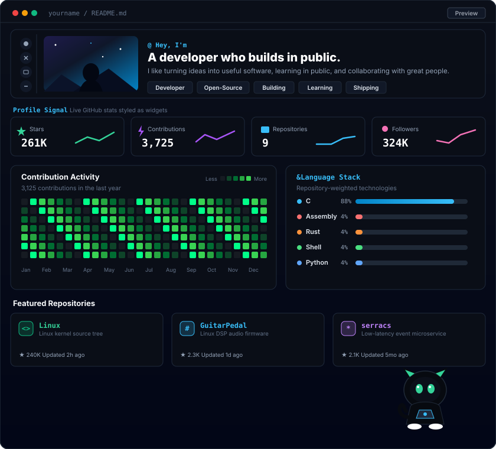
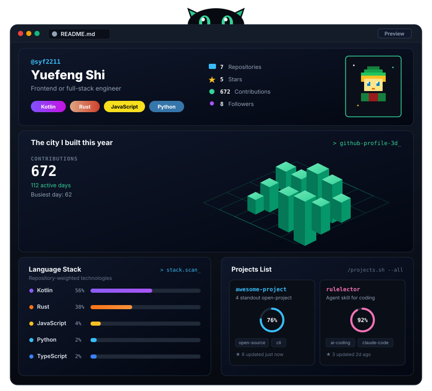
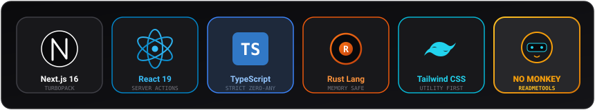
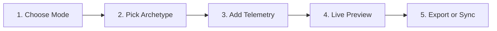
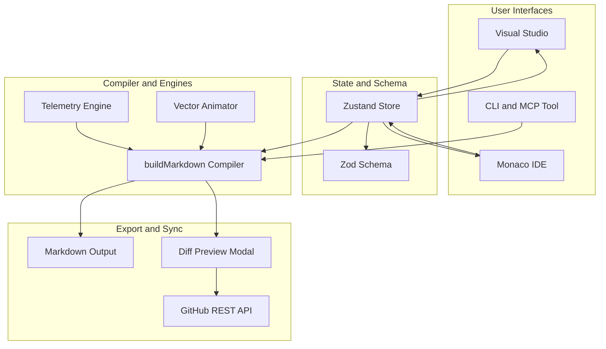

<div align="center" id="top">

  <!-- MonoForge Official Geometric Monkey Logo -->
  <a href="https://monoforge-studio.vercel.app/en">
    
  </a>

  <br />
  <br />

  <h1>MONOFORGE</h1>

  <p>
    <strong>Forge iconic GitHub profile READMEs with a visual studio, Monaco IDE split-preview, 60fps Camo-safe SVG animations, 30+ live telemetry visualizations, and confirmation-gated GitHub sync.</strong>
  </p>

  <p>
    <em>Forge a GitHub profile that gets noticed. 100% Free, Local-First, and Open Source.</em>
  </p>

  <p>
    <a href="https://github.com/yuvraj-thakur-exe/MONOFORGE/actions/workflows/ci.yml">
      
    </a>
    <a href="https://monoforge-studio.vercel.app/en">
      
    </a>
    <a href="https://github.com/yuvraj-thakur-exe/MONOFORGE/blob/main/LICENSE.md">
      
    </a>
    <a href="https://github.com/yuvraj-thakur-exe/MONOFORGE/stargazers">
      
    </a>
    <a href="https://github.com/yuvraj-thakur-exe/MONOFORGE/network/members">
      
    </a>
    <a href="https://github.com/yuvraj-thakur-exe/MONOFORGE/issues">
      
    </a>
  </p>

  <p>
    <a href="https://monoforge-studio.vercel.app/en"><strong>Launch Live Studio »</strong></a> •
    <a href="https://monoforge-studio.vercel.app/en/developer"><strong>Monaco Developer IDE »</strong></a> •
    <a href="https://monoforge-studio.vercel.app/en/templates"><strong>350+ Archetypes »</strong></a> •
    <a href="https://monoforge-studio.vercel.app/en/visualizer"><strong>30+ SVG Visualizations »</strong></a> •
    <a href="https://monoforge-studio.vercel.app/en/docs"><strong>Documentation »</strong></a>
  </p>

</div>

---

<!-- HERO WORKSTATION SHOWCASE -->
<p align="center">
  
</p>

---

## 30-Second Quickstart

Pick your fastest path to a production-ready GitHub Profile README:

- **1-Click Live Studio**: Open [monoforge-studio.vercel.app/en](https://monoforge-studio.vercel.app/en) to browse **350+ Profile Archetypes** and customize visually with zero setup.
- **Monaco Developer IDE**: Jump straight into [monoforge-studio.vercel.app/en/developer](https://monoforge-studio.vercel.app/en/developer) for split-screen JSON editing, live Zod schema diagnostics, and instant Markdown export.
- **1-Command CLI** *(zero install, runs directly from GitHub)*:

```bash
npx github:yuvraj-thakur-exe/MONOFORGE generate -u <your-github-username> -a wow-3d-city-cat
```

> Stream directly to stdout with `-o -`, or pipe straight into your profile repo:
> `npx github:yuvraj-thakur-exe/MONOFORGE generate -u <your-github-username> -o - > README.md`

### Why MonoForge?

| Capability | MonoForge | Legacy README Generators |
| :--- | :--- | :--- |
| **Camo-Safe 60fps SVGs** | Pure CSS `@keyframes`, zero `<script>`, zero `<foreignObject>`, `prefers-reduced-motion` | Static images or fragile external embeds |
| **Real GitHub Telemetry** | 30+ SVG visualizations & 20 telemetry engines powered by real contributor data | Hardcoded static counters or dead third-party links |
| **Monaco JSON IDE** | Full split-screen Monaco editor synced bidirectionally with Zustand + Zod schema | Form-only inputs with no raw AST/JSON control |
| **Confirmation-Gated Sync** | Side-by-side remote diff preview + explicit per-item confirmation before any write | Blind overwrite or manual copy-paste |
| **Archetype Library** | **350+ Profile Archetypes**, **22 Modular Plugins**, **47 Verified Social Icons** | Small handful of generic layouts |
| **Local-First Privacy** | Runs locally in your browser; optional tokens stay in memory and are never stored | Server-hosted sessions or tracking scripts |

<div align="center">
  <p>
    <strong>⭐ If MonoForge elevated your GitHub profile, <a href="https://github.com/yuvraj-thakur-exe/MONOFORGE">star the repository on GitHub</a> to support open-source development!</strong>
  </p>
</div>

---

## Table of Contents

- [Project Overview](#project-overview)
- [Previews and Interface Showcase](#previews-and-interface-showcase)
- [Features](#features)
  - [Visual Studio & Archetype Gallery](#1-visual-studio--archetype-gallery)
  - [Developer Raw Mode IDE](#2-developer-raw-mode-ide-developer)
  - [Telemetry & Visualization Engine](#3-telemetry--visualization-engine-telemetry--visualizer)
  - [60fps Camo Vector & Mascot System](#4-60fps-camo-vector--mascot-system)
  - [350+ Curated Profile Archetypes](#5-350-curated-profile-archetypes-templates)
  - [Confirmation-Gated GitHub Synchronization](#6-confirmation-gated-github-synchronization)
  - [Resume Import & Web Enrichment](#7-resume-import--web-enrichment)
  - [CLI & AI Agent MCP Server](#8-cli--ai-agent-mcp-server)
- [Tech Stack](#tech-stack)
- [Getting Started](#getting-started)
- [Installation](#installation)
- [Environment Configuration](#environment-configuration)
- [Usage Guide](#usage-guide)
- [CLI Documentation](#cli-documentation)
- [Project Architecture](#project-architecture)
- [Scripts and Commands](#scripts-and-commands)
- [Roadmap](#roadmap)
- [Contributing](#contributing)
- [Development Guidelines](#development-guidelines)
- [Issues and Support](#issues-and-support)
- [License](#license)
- [Acknowledgements](#acknowledgements)

---

## Project Overview

### What is MonoForge?

**MonoForge** is an open-source GitHub profile README engineering platform. It pairs a guided visual studio with a Monaco-powered raw JSON IDE, **350+ profile archetypes**, **22 modular plugins**, **30+ SVG telemetry visualizations**, **47 verified social icons**, and a 60fps GPU-accelerated SVG motion system.

### What Problem Does It Solve?

Traditional GitHub profiles are often built by copy-pasting Markdown snippets, manually assembling HTML tables, and linking fragile badges. That workflow is error-prone:
- Third-party badge servers frequently rate-limit, slow down page loads, or break under GitHub's **Camo CDN proxy**.
- Manual Markdown editing causes broken table columns, invalid HTML, and inconsistent visual styling.
- Static bullet lists fail to communicate actual engineering velocity, language distribution, and commit patterns.

### Who Should Use It?

- **Individual Software Engineers**: Showcase live repository metrics, technical specializations, and polished visual branding.
- **Open-Source Maintainers**: Present project roadmaps, contribution activity, and sponsorship details.
- **Engineering Teams & Organizations**: Establish unified profile standards and real-time contribution dashboards.

### Why Developers Choose MonoForge

1. **Pure Function Markdown Generation**: All output is produced by `buildMarkdown(config)`, a deterministic, side-effect-free compiler covered by automated unit tests.
2. **Single Source of Truth**: One unified Zustand store (`website/src/store/useReadmeStore.ts`) keeps the visual builder and `/developer` raw IDE in complete synchronization.
3. **GitHub Camo CDN Safe**: Animated vectors use native CSS `@keyframes` with `transform-box: fill-box; transform-origin: center;`, zero `<script>` tags, and zero `<foreignObject>` tags so animations render cleanly through GitHub's proxy.
4. **Strict Confirmation Gates**: No resume data or remote GitHub commits are ever written without explicit, per-item user confirmation and side-by-side diff review.

---

## Previews and Interface Showcase

MonoForge provides both individual developer profile components and full bento dashboards:

<table>
  <tr>
    <th width="50%" align="center">Bento Signal Dashboard</th>
    <th width="50%" align="center">3D Isometric Commit City</th>
  </tr>
  <tr>
    <td align="center">
      
      <br />
      <em>Live profile metrics: stars, commits, polyglot distribution, and repository signals.</em>
    </td>
    <td align="center">
      
      <br />
      <em>3D isometric contribution city paired with retro developer avatar and tech stack badges.</em>
    </td>
  </tr>
  <tr>
    <th align="center">Telemetry Habits &amp; Velocity Radar</th>
    <th align="center">Tactile Sticker Vault</th>
  </tr>
  <tr>
    <td align="center">
      
      <br />
      <em>Circadian rhythm commit velocity, active working hours, and pace tracking.</em>
    </td>
    <td align="center">
      
      <br />
      <em>Camo-compliant developer badges, status indicators, and sticker elements.</em>
    </td>
  </tr>
</table>

---

## Features

### 1. Visual Studio & Archetype Gallery
- **Guided Studio Workflow**: Assemble your profile header, bio, **47 verified social icons**, tech stack, and dynamic telemetry widgets.
- **Real-Time Preview**: Changes reflect immediately across responsive viewports.
- **Section Reordering & Toggles**: Enable, disable, and rearrange blocks to fit your desired layout.

### 2. Developer Raw Mode IDE (`/developer`)
- **Split-Screen Monaco Editor**: Full bidirectional sync with the application's central Zustand store (`website/src/store/useReadmeStore.ts`).
- **Zod Schema Validation**: Real-time syntax and AST schema diagnostics backed by `/api/schema` and `website/src/lib/plugins/types.ts`.
- **Multi-Device Viewport**: Toggle instantly between Desktop, Cyber CRT Terminal, and Mobile viewports.
- **Design Tokens**: Switch badge styles (`for-the-badge`, `flat`, `flat-square`) and attribution settings with a single click.

### 3. Telemetry & Visualization Engine (`/telemetry` & `/visualizer`)
Real dynamic contributor activity powered by **30+ SVG visualizations** and **20 telemetry plugins** via `/api/telemetry/svg`:
- **3D Isometric Calendar**: `/api/telemetry/svg?plugin=isocalendar&user=<username>`
- **3D Isometric Skyline**: `/api/telemetry/svg?plugin=city&user=<username>`
- **Harmonic Language River**: `/api/telemetry/svg?plugin=river&user=<username>`
- **Engineering Radar**: `/api/telemetry/svg?plugin=radar&user=<username>`
- **52-Week Contribution Heatmap**: `/api/telemetry/svg?plugin=heatmap&user=<username>`
- **Velocity & Streak**: `/api/telemetry/svg?plugin=velocity&user=<username>`
- **Fastfetch Terminal & Synthwave Bento**: `/api/telemetry/svg?plugin=neofetch&user=<username>` and `plugin=synthwave`
- **LeetCode, WakaTime & PageSpeed**: Problem stats, coding hours, and Lighthouse audit scores.

### 4. 60fps Camo Vector & Mascot System
- **Engineered for GitHub Camo**: Strict adherence to GitHub sanitization rules — zero `<script>`, zero `<foreignObject>`, and GPU-accelerated CSS `@keyframes`.
- **Animated Mascots**: Cyber Bot, Pixel Developer Desk, Coding Unicorn, Octocat Coffee, and Celebratory Owl.
- **Atmospheric Banners**: Matrix digital rain, waving neon gradients, starfield constellations, and CRT scanlines.
- **Accessibility**: Built-in `@media (prefers-reduced-motion: reduce)` fallbacks across all animated SVGs.

### 5. 350+ Curated Profile Archetypes (`/templates`)
Choose from **350+ profile archetypes** in the Web Studio (`359` curated catalog templates) plus **40 standalone CLI archetypes**:
- `wow-3d-city-cat`: 3D contribution city, retro pixel-art avatar, and glowing stack badges.
- `bento-signal-dashboard`: High-density bento grid featuring live metrics and contribution graphs.
- `forge-telemetry-dashboard`: Dark-mode systems engineering dashboard.
- `neon-craftsman-owl`: Waving purple neon banner with celebratory owl mascot.
- `minimal-light-unicorn`: Clean typography, checkmarked accomplishments, and pastel sticker accents.
- `isometric-terminal-connect`: 3D isometric terminal cube banner with glossy social badges.

### 6. Confirmation-Gated GitHub Synchronization
- Authenticated GitHub workflow via REST API (`website/src/lib/github/sync.ts`).
- Fetches real remote `README.md` content to compute a side-by-side diff preview (`website/src/components/sync/DiffPreview.tsx`).
- **Strict Invariant**: Zero writes occur without explicit "Confirm & push" verification by the user.

### 7. Resume Import & Web Enrichment
- Server-side extraction from `.pdf` and `.docx` resumes via `pdf-parse` and `mammoth`.
- Enrichment suggestions for missing social accounts, technologies, and project links.
- **Confirmation-Gated**: Discovered data is never written to the profile store without per-item user approval (`ConfirmGate.tsx`).

### 8. CLI & AI Agent MCP Server
- Standalone CLI packaged in `bin/monoforge.js` with zero runtime dependencies.
- Run straight from GitHub without npm publishing: `npx github:yuvraj-thakur-exe/MONOFORGE generate -u <handle>`.
- Native **Model Context Protocol (MCP)** stdio server for AI agents (`node bin/monoforge.js mcp`).

---

## Tech Stack

| Technology | Purpose | Implementation in Project |
| :--- | :--- | :--- |
| **Next.js 16** | Application Framework | App Router, Server Components, Turbopack, and dynamic route handlers (`/api/telemetry/*`). |
| **React 19** | User Interface | Modern hooks, concurrent rendering, and interactive studio state. |
| **TypeScript** | Type Safety | Strict compiler configuration (`website/tsconfig.json`) across models, plugins, and UI. |
| **Zustand 5** | State Management | Single source of truth (`website/src/store/useReadmeStore.ts`) shared between visual and raw editors. |
| **Zod 4** | Schema Validation | AST validation for profile configurations, resume payloads, and plugin options. |
| **Monaco Editor** | Raw Mode Editor | Split-screen JSON editing with live schema diagnostic markers (`@monaco-editor/react`). |
| **Tailwind CSS 4** | Styling & Design Tokens | Utility-first CSS using soft slate palettes, amber accents, and custom container scales. |
| **Radix UI** | Headless Primitives | Accessible dialogs, dropdowns, popovers, and switch controls. |
| **GitHub REST API** | GitHub Integration | Remote repo inspection, diff preview, and confirmation-gated commits (`website/src/lib/github/sync.ts`). |
| **Biome** | Code Quality | High-speed linting and formatting (`biome check website/src`). |
| **Vitest 4** | Unit Testing | Fast test runner covering **170+ automated test files** in `website/src/`. |
| **Playwright** | E2E Testing | Cross-browser end-to-end testing for visual flows and export pipelines. |

---

## Getting Started

### Prerequisites

Ensure you have the following installed on your machine:
- **Node.js**: `v20.x` or later (LTS recommended)
- **pnpm**: `v10.x` (`10.12.4` via Corepack)

To enable `pnpm` globally via Corepack:

```bash
corepack enable
corepack prepare pnpm@10.12.4 --activate
```

---

## Installation

### Fast 1-Line Local Studio Setup

- **macOS / Linux**:
  ```bash
  curl -fsSL https://raw.githubusercontent.com/yuvraj-thakur-exe/MONOFORGE/main/install.sh | bash
  ```
- **Windows (PowerShell)**:
  ```powershell
  iwr -useb https://raw.githubusercontent.com/yuvraj-thakur-exe/MONOFORGE/main/install.ps1 | iex
  ```

### Manual Setup

1. **Clone the repository:**

   ```bash
   git clone https://github.com/yuvraj-thakur-exe/MONOFORGE.git
   cd MONOFORGE
   ```

2. **Install project dependencies:**

   ```bash
   pnpm install
   ```

3. **Configure environment variables (optional):**

   ```bash
   cp .env.example .env.local
   ```

4. **Start the local development server:**

   ```bash
   pnpm dev
   ```

5. **Open your browser:**
   - **Main Studio**: [http://localhost:3000/en](http://localhost:3000/en)
   - **Developer IDE**: [http://localhost:3000/en/developer](http://localhost:3000/en/developer)
   - **Archetype Gallery**: [http://localhost:3000/en/templates](http://localhost:3000/en/templates)
   - **Telemetry Arsenal**: [http://localhost:3000/en/telemetry](http://localhost:3000/en/telemetry)
   - **SVG Visualizer**: [http://localhost:3000/en/visualizer](http://localhost:3000/en/visualizer)

---

## Environment Configuration

MonoForge runs locally without mandatory credentials. To enable authenticated GitHub push synchronization or optional WakaTime metrics locally, configure `.env.local` from [`.env.example`](.env.example):

```env
# MonoForge Environment Configuration

# NextAuth / GitHub OAuth (Optional — for GitHub OAuth / local sync flows)
# Create a GitHub OAuth App at: https://github.com/settings/developers
GITHUB_ID=""
GITHUB_SECRET=""
NEXTAUTH_URL="http://localhost:3000"
NEXTAUTH_SECRET="your-generated-nextauth-secret-key"

# Optional: WakaTime Integration
WAKATIME_API_KEY=""

# Public Application URL
NEXT_PUBLIC_APP_URL="http://localhost:3000"
```

### Variable Details

| Variable | Requirement | Description |
| :--- | :---: | :--- |
| `GITHUB_ID` | Optional | GitHub OAuth Client ID for local OAuth configuration. |
| `GITHUB_SECRET` | Optional | GitHub OAuth Client Secret. |
| `NEXTAUTH_URL` | Optional | Canonical URL of the application (`http://localhost:3000` locally). |
| `NEXTAUTH_SECRET` | Optional | Secret string used to sign session cookies when OAuth is enabled. |
| `WAKATIME_API_KEY` | Optional | API token used to fetch coding time telemetry from WakaTime. |
| `NEXT_PUBLIC_APP_URL` | Optional | Base URL for resolving canonical URLs, OpenGraph images, and sitemaps. |

---

## Usage Guide

Follow this workflow to engineer your GitHub profile README:



1. **Select an Archetype or Start from Scratch**:
   - Browse **350+ starter templates** at `/en/templates`.
   - Click **Use Template** to populate the central Zustand store.
2. **Customize in Studio or Raw IDE (`/en/developer`)**:
   - Edit sections visually in the Studio or edit raw JSON directly in Monaco with live `/api/schema` validation.
3. **Configure Live Telemetry Plugins**:
   - Add 3D isometric contribution calendars, Commit City skylines, language rivers, or PageSpeed scorecards.
4. **Inspect Live Multi-Device Previews**:
   - Switch between Desktop, Cyber CRT Terminal, and Mobile viewports to verify responsiveness.
5. **Export or Push to GitHub**:
   - **Option A (Instant Copy)**: Click **Copy README** in the export bar to copy production-ready Markdown.
   - **Option B (Direct GitHub Sync)**: Click **Sync to GitHub**, review the side-by-side remote diff preview, and confirm the commit.

---

## CLI Documentation

MonoForge includes a standalone command-line tool (`bin/monoforge.js`) that runs with Node.js 18+ with zero external package dependencies.

> **Note**: Root `package.json` is marked `"private": true` for the monorepo web studio. Run the CLI directly from GitHub via `npx github:yuvraj-thakur-exe/MONOFORGE` or locally from a cloned checkout with `node bin/monoforge.js`.

### Execution

Run directly from GitHub without cloning:

```bash
npx github:yuvraj-thakur-exe/MONOFORGE generate --username <handle> [options]
```

Or locally inside a cloned repo:

```bash
node bin/monoforge.js generate --username <handle> [options]
```

### Available Commands

| Command | Description | Example |
| :--- | :--- | :--- |
| `generate` | Forge a complete GitHub profile README.md | `npx github:yuvraj-thakur-exe/MONOFORGE generate --username octocat` |
| `list` | List all 40 standalone CLI visual archetypes | `npx github:yuvraj-thakur-exe/MONOFORGE list` |
| `skill-install` | Install MonoForge as an AI Agent Skill (`.agents/skills/monoforge/`) | `npx github:yuvraj-thakur-exe/MONOFORGE skill-install` |
| `mcp` | Start Model Context Protocol (MCP) stdio server for AI agents | `npx github:yuvraj-thakur-exe/MONOFORGE mcp` |

### Command Options

```text
OPTIONS:
  --username, -u    GitHub username (default: 'octocat')
  --archetype, -a   Archetype ID (default: 'wow-3d-city-cat')
  --output, -o      Output file path (default: 'README.md', use '-' for stdout)
  --name            Display name (default: auto-detected or persona name)
  --role            Developer headline or role
  --help, -h        Show help message
```

### Practical CLI Examples

```bash
# 1. Generate the #1 Wow Profile with 3D City & Peeking Cat
npx github:yuvraj-thakur-exe/MONOFORGE generate --username octocat --archetype wow-3d-city-cat

# 2. Generate Bento Signal Dashboard to a custom path
npx github:yuvraj-thakur-exe/MONOFORGE generate --username octocat --archetype bento-signal-dashboard --output ./PROFILE.md

# 3. Stream generated Markdown directly to stdout
npx github:yuvraj-thakur-exe/MONOFORGE generate -u octocat -o - > README.md

# 4. Install MonoForge AI Agent skill into current repository
npx github:yuvraj-thakur-exe/MONOFORGE skill-install
```

---

## Project Architecture

### Architectural Invariants

MonoForge is governed by four strict architectural rules (see [`AGENTS.md`](AGENTS.md)):

1. **One Zustand Store (`website/src/store/useReadmeStore.ts`)**: Holds all profile state. Both the visual studio and `/developer` raw editor read and write to this single store.
2. **Pure `buildMarkdown(config)` Generator (`website/src/lib/buildMarkdown.ts`)**: A pure function with zero React dependencies and zero side effects. Any formatting change passes through this function and its Vitest suite.
3. **Registry-Driven Plugins (`website/src/lib/plugins/registry.ts`)**: Plugins are plain objects validated against the Zod schema in `website/src/lib/plugins/types.ts`. Adding a plugin requires zero changes to core wizard or editor logic.
4. **Mandatory Confirmation Gates**: Neither resume extraction nor remote GitHub commits can write to state or repositories without explicit user review.

### Architecture Data Flow



### Documentation Index

- [OSS Integration Map](docs/OSS-INTEGRATION-MAP.md) — Evaluated open-source libraries, licenses, and integration guidelines.
- [AI Agent Integration Architecture](docs/ai/README-AGENT-INTEGRATION.md) — 30 signature visualizations, normalized identity model, and agent architecture.
- [README Output Compatibility & Security](docs/README-OUTPUT-COMPATIBILITY.md) — GitHub Camo SVG allowlist, reduced motion, and asset caps.
- [Agent Acceptance Tests](docs/README-AGENT-ACCEPTANCE-TESTS.md) — End-to-end verification scenarios for generated profiles and assets.
- [Online Documentation](https://monoforge-studio.vercel.app/en/docs) — Interactive guides and telemetry references.

### Directory Map

```text
MONOFORGE/
├── .github/                      # CI workflows, funding, issue & PR templates
│   └── workflows/ci.yml          # Automated type-check, Vitest, CLI smoke, build & E2E
├── bin/
│   └── monoforge.js              # Standalone CLI, 40 archetypes, and MCP stdio server
├── docs/                         # Architecture, compatibility, and AI agent docs
│   ├── ai/README-AGENT-INTEGRATION.md
│   ├── OSS-INTEGRATION-MAP.md
│   ├── README-AGENT-ACCEPTANCE-TESTS.md
│   └── README-OUTPUT-COMPATIBILITY.md
├── public/
│   └── assets/                   # Canonical SVGs, mascots, and 47 social icon sets
├── scripts/                      # SVG export & manifest automation scripts
├── website/
│   ├── public/                   # Hosted app assets, robots.txt, llms.txt
│   └── src/
│       ├── app/                  # Next.js 16 App Router ([locale], /developer, /templates, /telemetry, /visualizer, api/*)
│       ├── components/
│       │   ├── developer/        # Monaco raw editor, plugin panel, export bar, optimize modal
│       │   ├── enrichment/       # Resume upload and confirmation gates
│       │   ├── landing/          # Template gallery and full profile modals
│       │   ├── studio/           # Hero, bento showcases, health score, asset vault
│       │   └── sync/             # GitHub diff preview and push modals
│       ├── lib/
│       │   ├── buildMarkdown.ts  # Pure Markdown compiler (unit tested)
│       │   ├── github/           # GitHub REST sync & contributions fetcher
│       │   ├── plugins/          # 22 modular plugins + Zod schema types
│       │   ├── templates/        # 359 curated profile archetypes
│       │   └── visualizations/   # 30 SVG visualization generators
│       ├── store/
│       │   └── useReadmeStore.ts # Single source of truth Zustand store
│       └── translations/         # i18n locale bundles (en.json, pt-BR.json)
├── vitest.config.ts              # Vitest test runner scoped to website/src/
└── package.json                  # Workspace scripts and dependencies
```

---

## Scripts and Commands

All verified scripts available in [`package.json`](package.json):

| Command | Description |
| :--- | :--- |
| `pnpm dev` | Starts the Next.js development server with Turbopack on `http://localhost:3000`. |
| `pnpm build` | Compiles an optimized production build and prerenders static routes. |
| `pnpm start` | Runs the compiled production server. |
| `pnpm lint` | Runs Biome checks across `website/src/`. |
| `pnpm format` | Formats source files in `website/src/` using Biome. |
| `pnpm format:check` | Verifies `website/src/` adheres to Biome formatting rules without writing changes. |
| `pnpm type-check` | Executes TypeScript type checking (`tsc -p website/tsconfig.json --noEmit`). |
| `pnpm test` | Runs the Vitest unit test suite (**170+ test files** under `website/src/`). |
| `pnpm test:watch` | Starts Vitest in interactive watch mode for active development. |
| `pnpm test:coverage` | Generates V8 test coverage reports. |
| `pnpm test:e2e` | Executes Playwright end-to-end browser tests. |
| `pnpm analyze` | Builds the project with `@next/bundle-analyzer` enabled. |
| `pnpm export:telemetry` | Exports static telemetry SVG assets via `tsx scripts/export-telemetry-svgs.ts`. |

---

## Roadmap

### Completed (v1.0.0)
- [x] Unified Zustand store shared across Visual Studio and Monaco Raw IDE (`/developer`).
- [x] Pure function `buildMarkdown(config)` compiler with comprehensive Vitest suite.
- [x] 30+ SVG telemetry visualizations & 20 telemetry engine plugins.
- [x] 60fps Camo-compliant SVG character kinematics with zero JavaScript.
- [x] 350+ curated profile archetypes with 1-click customization.
- [x] Confirmation-gated direct GitHub push sync with side-by-side diff review.
- [x] Standalone CLI (`bin/monoforge.js`) and Model Context Protocol (MCP) stdio server.
- [x] Internationalization (i18n) support for English and Portuguese (`pt-BR`).
- [x] Core Web Vitals optimization and dynamic `sitemap.ts` / `robots.ts` / `llms.txt` discovery.

### In Progress
- [ ] Multi-account GitHub profile synchronization.
- [ ] Expanded animated retro arcade games with customizable sprite palettes.
- [ ] Automated dependency vulnerability audit badges in generated profiles.

### Planned
- [ ] Community telemetry plugin marketplace submission workflow.
- [ ] Team and organization multi-contributor profile aggregation.

---

## Contributing

We welcome contributions from developers of all skill levels! To contribute:

1. **Fork the repository** on GitHub: [https://github.com/yuvraj-thakur-exe/MONOFORGE/fork](https://github.com/yuvraj-thakur-exe/MONOFORGE/fork)
2. **Clone your fork locally**:
   ```bash
   git clone https://github.com/<your-username>/MONOFORGE.git
   cd MONOFORGE
   ```
3. **Create a descriptive feature branch**:
   ```bash
   git checkout -b feat/your-feature-name
   ```
4. **Make your changes** following the [Development Guidelines](#development-guidelines).
5. **Run tests and type checks**:
   ```bash
   pnpm type-check
   pnpm test
   pnpm lint
   ```
6. **Commit your changes** using [Conventional Commits](https://www.conventionalcommits.org/):
   ```bash
   git commit -m "feat(plugin): add stackshare tech radar telemetry engine"
   ```
7. **Push to your fork and submit a Pull Request**:
   - Provide a clear summary of your changes.
   - Reference any related open issues.

See [CONTRIBUTING.md](CONTRIBUTING.md) for full contribution guidelines.

---

## Development Guidelines

- **Code Quality**: Run `pnpm type-check`, `pnpm test`, and `pnpm lint` before submitting changes.
- **Architectural Integrity**:
  - Never introduce parallel state stores. Always read and write through `website/src/store/useReadmeStore.ts`.
  - Keep `website/src/lib/plugins/types.ts` and `/api/schema` aligned whenever modifying the profile config shape.
  - If you touch `buildMarkdown.ts` or add a plugin, add or update its corresponding Vitest test.
- **Color Palette Invariant**: Avoid harsh pitch black (`#000000`, `#0a0a0a`, `#18181b`). Use refined slates (`#1e293b`, `#334155`, `#475569`, `#64748b`), warm cream/white (`#fafbfc`, `#f8fafc`), amber accents (`#f59e0b`, `#ffe600`), and GitHub emerald (`#10b981`).
- **SVG Camo Rules**: All animated SVGs must use `transform-box: fill-box; transform-origin: center;`, include `@media (prefers-reduced-motion: reduce)`, and contain **zero `<script>` tags** and **zero `<foreignObject>` tags**.
- **User-Facing Copy**: Never hardcode user-facing strings in UI components. Add keys to `website/src/translations/en.json` and `website/src/translations/pt-BR.json`.

---

## Issues and Support

- **Bug Reports**: Open a bug report using our [Bug Report Template](https://github.com/yuvraj-thakur-exe/MONOFORGE/issues/new?template=bug_report.yml).
- **Feature Requests**: Have an idea for a new archetype or visual component? Submit a [Feature Request](https://github.com/yuvraj-thakur-exe/MONOFORGE/issues/new?template=feature_request.yml).
- **Telemetry Plugin Proposals**: Want to see a new data engine? Propose it via the [Telemetry Plugin Request](https://github.com/yuvraj-thakur-exe/MONOFORGE/issues/new?template=telemetry_plugin_request.md).
- **Community Discussions**: Ask questions or share your forged profile in [GitHub Discussions](https://github.com/yuvraj-thakur-exe/MONOFORGE/discussions).

---

## License

This project is licensed under the **MIT License**.

See the full license text in the [LICENSE.md](LICENSE.md) file.

---

## Acknowledgements

MonoForge is built with pride upon exceptional open-source tools and resources:
- [Devicon](https://devicon.dev/) and [Skill Icons](https://skillicons.dev/) for developer language and tool logos.
- [GitHub Readme Stats](https://github.com/anuraghazra/github-readme-stats) for stats card inspiration.
- [Monaco Editor](https://microsoft.github.io/monaco-editor/) for in-browser IDE capabilities.
- [Radix UI](https://www.radix-ui.com/) and [Tailwind CSS](https://tailwindcss.com/) for UI primitives and typography.
- [Octokit](https://github.com/octokit) for GitHub REST API integrations.

---

<div align="center">

  <br />

  <p>
    <strong>⭐ If MonoForge elevated your GitHub profile, please give the repository a star on GitHub:</strong><br />
    <a href="https://github.com/yuvraj-thakur-exe/MONOFORGE"><strong>https://github.com/yuvraj-thakur-exe/MONOFORGE</strong></a>
  </p>

  <br />

  <sub>Engineered with precision by Yuvraj Vinod Thakur and open-source contributors worldwide. Powered by Next.js 16, Turbopack, and Camo-Safe SVG Kinematics.</sub>

</div>
