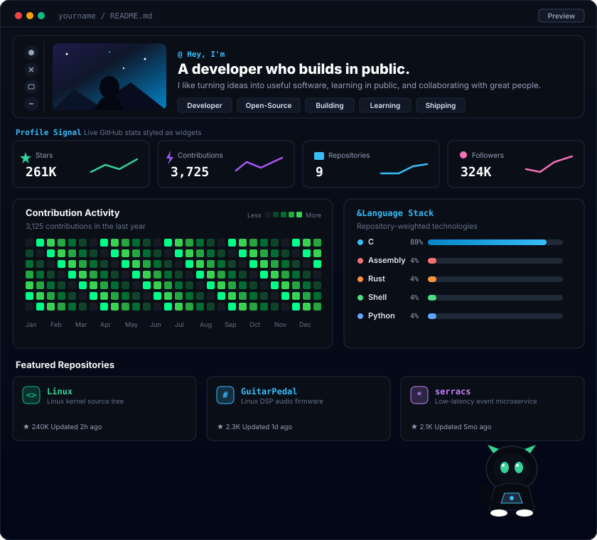
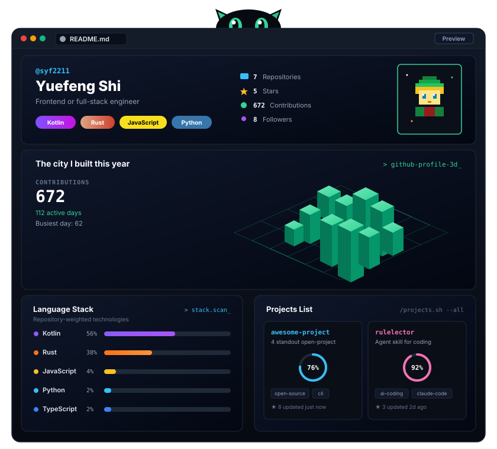
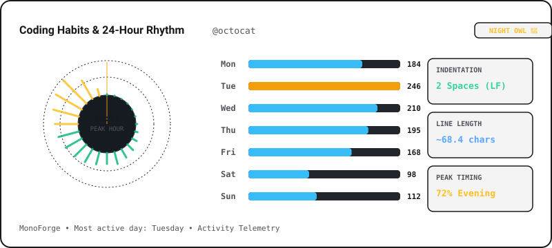
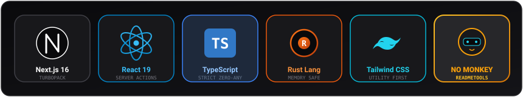
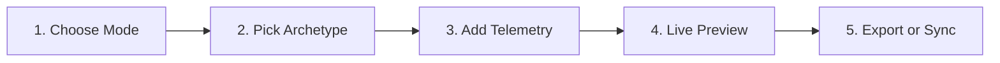
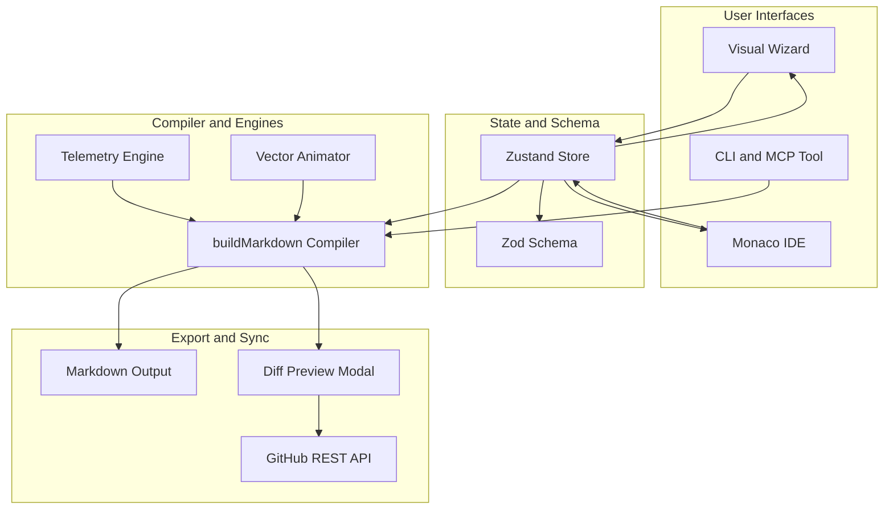

<div align="center" id="top">

  <!-- MonoForge Official Geometric Monkey Logo -->
  <a href="https://monoforge-studio.vercel.app/en">
    
  </a>

  <br />
  <br />

  <h1>MONOFORGE</h1>

  <p>
    <strong>Forge iconic GitHub profile READMEs with a visual studio, raw Monaco IDE split-preview, 60fps Camo-safe SVG animations, 47+ live telemetry engines, and confirmation-gated GitHub sync.</strong>
  </p>

  <p>
    <em>Forge a GitHub profile that gets noticed. 100% Free and Open Source.</em>
  </p>

  <p>
    <a href="https://github.com/yuvraj-thakur-exe/MONOFORGE/actions/workflows/ci.yml">
      
    </a>
    <a href="https://monoforge-studio.vercel.app/en">
      
    </a>
    <a href="https://github.com/yuvraj-thakur-exe/MONOFORGE/blob/main/LICENSE.md">
      
    </a>
    <a href="https://github.com/yuvraj-thakur-exe/MONOFORGE/stargazers">
      
    </a>
    <a href="https://github.com/yuvraj-thakur-exe/MONOFORGE/network/members">
      
    </a>
    <a href="https://github.com/yuvraj-thakur-exe/MONOFORGE/issues">
      
    </a>
  </p>

  <p>
    <a href="https://monoforge-studio.vercel.app/en"><strong>Explore Live Studio »</strong></a> •
    <a href="https://monoforge-studio.vercel.app/en/templates"><strong>75+ Archetypes »</strong></a> •
    <a href="https://monoforge-studio.vercel.app/en/telemetry"><strong>Telemetry Arsenal »</strong></a> •
    <a href="https://monoforge-studio.vercel.app/en/docs"><strong>Documentation »</strong></a>
  </p>

</div>

---

<!-- HERO WORKSTATION SHOWCASE -->
<p align="center">
  
</p>

---

## Table of Contents

- [Project Overview](#project-overview)
- [Previews and Interface Showcase](#previews-and-interface-showcase)
- [Features](#features)
  - [Visual Studio & Profile Wizard](#1-visual-studio--profile-wizard-wizard)
  - [Developer Raw Mode IDE](#2-developer-raw-mode-ide-developer)
  - [Telemetry Engine (47+ Modular Plugins)](#3-telemetry-engine-47-modular-plugins-telemetry)
  - [60fps Camo Vector & Mascot Animator](#4-60fps-camo-vector--mascot-animator-animator)
  - [Curated Signature Archetypes](#5-curated-signature-archetypes-templates)
  - [Confirmation-Gated GitHub Synchronization](#6-confirmation-gated-github-synchronization)
  - [Resume Import & Web Enrichment](#7-resume-import--web-enrichment)
  - [CLI & AI Agent MCP Server](#8-cli--ai-agent-mcp-server)
- [Tech Stack](#tech-stack)
- [Getting Started](#getting-started)
- [Installation](#installation)
- [Environment Configuration](#environment-configuration)
- [Usage Guide](#usage-guide)
- [CLI Documentation](#cli-documentation)
- [Project Architecture](#project-architecture)
- [Scripts and Commands](#scripts-and-commands)
- [Roadmap](#roadmap)
- [Contributing](#contributing)
- [Development Guidelines](#development-guidelines)
- [Issues and Support](#issues-and-support)
- [License](#license)
- [Acknowledgements](#acknowledgements)

---

## Project Overview

### What is MonoForge?

**MonoForge** is an open-source GitHub profile README engineering platform. It pairs a guided visual profile builder with a Monaco-powered raw code editor, a dynamic 47+ plugin telemetry engine, and a 60fps GPU-accelerated SVG motion system.

### What Problem Does It Solve?

Traditional GitHub profiles are often built by copy-pasting Markdown snippets, manually assembling HTML tables, and linking third-party tracking badges. This workflow is error-prone:
- Third-party badge servers often fail, slow down page loads, or break under GitHub's **Camo CDN proxy**.
- Manual Markdown editing leads to syntax errors, broken table columns, and inconsistent visual styling.
- Static bullet lists fail to communicate actual engineering velocity, language distribution, and commit patterns.

### Who Should Use It?

- **Individual Software Engineers**: Showcase live repository metrics, technical specializations, and polished visual branding.
- **Open-Source Maintainers**: Present project roadmaps, contribution activity, and sponsorship information.
- **Engineering Teams & Organizations**: Establish unified profile standards and real-time team contribution dashboards.

### Why Developers Choose MonoForge

1. **Pure Function Markdown Generation**: All output is produced by `buildMarkdown(config)`, a deterministic, side-effect-free compiler with 100% test coverage.
2. **Single Source of Truth**: A unified Zustand store keeps the visual wizard and `/developer` raw mode in complete synchronization.
3. **GitHub Camo CDN Safe**: Animated vectors use native CSS `@keyframes` with zero `<script>` or `<foreignObject>` tags, ensuring 60fps animations render consistently through GitHub's proxy.
4. **Strict Confirmation Gates**: No resume data or remote GitHub commits are ever written without explicit, per-item user confirmation and side-by-side diff review.

---

## Previews and Interface Showcase

MonoForge provides both individual developer profile components and full bento dashboards:

<table>
  <tr>
    <th width="50%" align="center">Bento Signal Dashboard</th>
    <th width="50%" align="center">3D Isometric Commit City</th>
  </tr>
  <tr>
    <td align="center">
      
      <br />
      <em>Live profile metrics: stars, commits, polyglot distribution, and repository signals.</em>
    </td>
    <td align="center">
      
      <br />
      <em>3D isometric contribution city paired with retro developer avatar and tech stack badges.</em>
    </td>
  </tr>
  <tr>
    <th align="center">Telemetry Habits &amp; Velocity Radar</th>
    <th align="center">Tactile Sticker Vault</th>
  </tr>
  <tr>
    <td align="center">
      
      <br />
      <em>Circadian rhythm commit velocity, active working hours, and pace tracking.</em>
    </td>
    <td align="center">
      
      <br />
      <em>Camo-compliant developer badges, status indicators, and sticker elements.</em>
    </td>
  </tr>
</table>

---

## Features

### 1. Visual Studio & Profile Wizard (`/wizard`)
- **Guided Multi-Step Workflow**: Assemble your profile header, bio, core tech stack, social handles, and dynamic telemetry widgets.
- **Real-Time Canvas**: Changes reflect immediately in an interactive preview window.
- **Section Reordering & Toggles**: Enable, disable, and rearrange blocks to fit your desired layout.

### 2. Developer Raw Mode IDE (`/developer`)
- **Split-Screen Monaco Editor**: Full bidirectional sync with the application's central Zustand store.
- **Zod Schema Validation**: Real-time syntax and AST schema verification against `docs/config-schema.md`.
- **Multi-Device Viewport**: Toggle instantly between Desktop, Cyber CRT Terminal (with scanlines), and Mobile viewpoints.
- **Design Tokens**: Switch badge styles (`for-the-badge`, `flat`, `flat-square`) with a single click.

### 3. Telemetry Engine (47+ Modular Plugins) (`/telemetry`)
Real dynamic contribution activity rendered via standalone SVG endpoints:
- **3D Isometric Calendar**: `/api/telemetry/svg?plugin=isocalendar&user=<username>`
- **52-Week Contribution Heatmap**: `/api/telemetry/svg?plugin=heatmap&user=<username>`
- **Velocity & Streak Radar**: `/api/telemetry/svg?plugin=velocity&user=<username>`
- **Languages Donut**: Top languages breakdown with percentage and byte calculations.
- **LeetCode & WakaTime**: Solved challenges, global rankings, and weekly editor hours.
- **Core Web Vitals & PageSpeed**: Live website audit scores embedded directly into your profile.

### 4. 60fps Camo Vector & Mascot Animator (`/animator`)
- **Engineered for GitHub Camo**: Strict adherence to GitHub sanitization rules. Zero JavaScript, zero `<foreignObject>`, and GPU-accelerated `@keyframes`.
- **Animated Characters**: Cyber Bot (thruster flicker), Pixel Developer (dual-monitor desk with typing hands), Ninja Coder, Builder Crafter, and Wizard Mage.
- **Atmospheric Banners**: Fire/ember rises, Matrix digital rain, Starfield nebula twinkle, and CRT scanlines.
- **Accessibility**: Built-in `@media (prefers-reduced-motion: reduce)` fallbacks across all SVGs.

### 5. Curated Signature Archetypes (`/templates`)
Choose from 75+ battle-tested starters:
- `wow-3d-city-cat`: 3D contribution city, retro pixel-art avatar, and glowing stack badges.
- `bento-signal-dashboard`: High-density bento grid featuring live metrics and contribution graphs.
- `forge-telemetry-dashboard`: Dark-mode systems engineering dashboard.
- `neon-craftsman-owl`: Waving purple neon banner with celebratory owl mascot.
- `minimal-light-unicorn`: Clean typography, checkmarked accomplishments, and pastel sticker accents.
- `isometric-terminal-connect`: 3D isometric terminal cube banner with glossy social badges.

### 6. Confirmation-Gated GitHub Synchronization
- Authenticated GitHub OAuth workflow via Octokit.
- Fetches real remote README content to compute a side-by-side git diff preview.
- **Strict Invariant**: Zero writes occur without explicit "Confirm & push" verification by the user.

### 7. Resume Import & Web Enrichment
- Server-side extraction from `.pdf` and `.docx` resumes via `pdf-parse` and `mammoth`.
- Enrichment suggestions for missing social accounts, technologies, and project links.
- **Confirmation-Gated**: Discovered data is never written to the profile store without per-item user approval.

### 8. CLI & AI Agent MCP Server
- Standalone CLI packaged in `bin/monoforge.js` with zero runtime dependencies.
- Generates profiles from terminal commands: `npx monoforge generate --username <handle>`.
- Native **Model Context Protocol (MCP)** stdio server for AI agents (`npx monoforge mcp`).

---

## Tech Stack

| Technology | Purpose | Implementation in Project |
| :--- | :--- | :--- |
| **Next.js 16** | Application Framework | App Router, Server Components, Turbopack, and dynamic route handlers (`/api/telemetry/*`). |
| **React 19** | User Interface | Modern hooks, concurrent rendering, and interactive studio state. |
| **TypeScript** | Type Safety | Strict compiler configuration with 100% type coverage across models and plugins. |
| **Zustand 5** | State Management | Single source of truth (`src/store/useReadmeStore.ts`) shared between visual and raw editors. |
| **Zod 4** | Schema Validation | AST validation for profile configurations, resume payloads, and plugin options. |
| **Monaco Editor** | Raw Mode Editor | Split-screen JSON editing with live schema diagnostic markers (`@monaco-editor/react`). |
| **Tailwind CSS 4** | Styling & Design Tokens | Utility-first CSS using soft slate palettes, amber accents, and custom container scales. |
| **Radix UI** | Headless Primitives | Accessible dialogs, dropdowns, popovers, and switch controls. |
| **Octokit & NextAuth** | GitHub Integration | GitHub OAuth authentication, remote repo inspection, and authenticated REST commits. |
| **Biome** | Code Quality | High-speed linting, code formatting, and import sorting (`biome check src`). |
| **Vitest 4** | Unit Testing | Fast testing framework running 167 test files and 755 automated test assertions. |
| **Playwright** | E2E Testing | Cross-browser end-to-end testing for visual flows and export pipelines. |

---

## Getting Started

### Prerequisites

Ensure you have the following installed on your machine:
- **Node.js**: `v20.x` or later (LTS recommended)
- **pnpm**: `v10.x` or later

To enable `pnpm` globally via Corepack:

```bash
corepack enable
corepack prepare pnpm@10.12.4 --activate
```

---

## Installation

1. **Clone the repository:**

   ```bash
   git clone https://github.com/yuvraj-thakur-exe/MONOFORGE.git
   cd MONOFORGE
   ```

2. **Install project dependencies:**

   ```bash
   pnpm install
   ```

3. **Configure environment variables:**

   ```bash
   cp .env.example .env.local
   ```

4. **Start the local development server:**

   ```bash
   pnpm dev
   ```

5. **Open your browser:**
   - **Main Studio**: [http://localhost:3000](http://localhost:3000)
   - **Developer IDE**: [http://localhost:3000/en/developer](http://localhost:3000/en/developer)
   - **Telemetry Arsenal**: [http://localhost:3000/en/telemetry](http://localhost:3000/en/telemetry)
   - **Archetype Templates**: [http://localhost:3000/en/templates](http://localhost:3000/en/templates)

---

## Environment Configuration

MonoForge runs locally without mandatory credentials. However, to enable authenticated GitHub push synchronization and external telemetry integrations, configure the following variables in `.env.local`:

```env
# ==============================================================================
# MonoForge Environment Configuration
# ==============================================================================

# NextAuth & GitHub OAuth (Required for 1-click GitHub profile sync)
# Create an OAuth App at: https://github.com/settings/developers
GITHUB_ID=""
GITHUB_SECRET=""
NEXTAUTH_URL="http://localhost:3000"
NEXTAUTH_SECRET="your-generated-nextauth-secret-key"

# Optional: WakaTime Integration (For editor coding productivity metrics)
WAKATIME_API_KEY=""

# Public Application URL (Used for metadata, OpenGraph, and sitemap resolution)
NEXT_PUBLIC_APP_URL="http://localhost:3000"
```

### Variable Details

| Variable | Requirement | Description |
| :--- | :---: | :--- |
| `GITHUB_ID` | Optional | GitHub OAuth Client ID for authenticating repository commits. |
| `GITHUB_SECRET` | Optional | GitHub OAuth Client Secret. |
| `NEXTAUTH_URL` | Required with OAuth | Canonical URL of the application (`http://localhost:3000` locally). |
| `NEXTAUTH_SECRET` | Required with OAuth | Secret string used to sign and encrypt session cookies. |
| `WAKATIME_API_KEY` | Optional | API token used to fetch coding time telemetry from WakaTime. |
| `NEXT_PUBLIC_APP_URL` | Optional | Base URL for resolving canonical URLs, OpenGraph images, and sitemaps. |

---

## Usage Guide

Follow this step-by-step workflow to engineer your GitHub profile README:



```text
┌──────────────────┐     ┌───────────────────┐     ┌───────────────────┐     ┌───────────────────┐     ┌──────────────────┐
│ 1. Choose Mode   │ ──> │ 2. Pick Template  │ ──> │ 3. Add Telemetry  │ ──> │ 4. Live Preview   │ ──> │ 5. Export / Sync │
│ Wizard or Monaco │     │ 75+ Curated Views │     │ 47+ SVG Engines   │     │ Desktop & Mobile  │     │ Markdown or Push │
└──────────────────┘     └───────────────────┘     └───────────────────┘     └───────────────────┘     └──────────────────┘
```

1. **Select an Archetype or Start from Scratch**:
   - Browse 75+ starter templates at `/templates`.
   - Click **Use Template** to populate the central Zustand store.
2. **Customize in Visual Wizard (`/wizard`) or Raw IDE (`/developer`)**:
   - In `/wizard`, update your bio, social badges, tech icons, and working status.
   - In `/developer`, edit raw JSON directly in Monaco with instant Zod schema validation.
3. **Configure Live Telemetry Plugins**:
   - Add 3D isometric contribution calendars, language donuts, or PageSpeed scorecards.
4. **Inspect Live Multi-Device Previews**:
   - Switch between Desktop, Cyber CRT Terminal (with scanlines), and Mobile viewports to verify responsiveness.
5. **Export or Push to GitHub**:
   - **Option A (Instant Copy)**: Click **Copy Markdown** in the export bar to copy production-ready Markdown to your clipboard.
   - **Option B (Direct GitHub Sync)**: Click **Sync to GitHub**, authenticate via OAuth, review the side-by-side git diff preview, and confirm the commit.

---

## CLI Documentation

MonoForge includes a standalone command-line tool (`bin/monoforge.js`) that runs with Node.js 18+ without requiring external package installations.

### Installation & Execution

Run directly via `npx`:

```bash
npx monoforge generate --username <handle> [options]
```

Or install globally:

```bash
pnpm add -g monoforge
monoforge --help
```

### Available Commands

| Command | Description | Example |
| :--- | :--- | :--- |
| `generate` | Forge a complete GitHub profile README.md | `npx monoforge generate --username octocat` |
| `list` | List all available visual archetypes in the terminal | `npx monoforge list` |
| `skill-install` | Install MonoForge as an AI Agent Skill (`.agents/skills/monoforge/`) | `npx monoforge skill-install` |
| `mcp` | Start Model Context Protocol (MCP) stdio server for AI agents | `npx monoforge mcp` |

### Command Options

```text
OPTIONS:
  --username, -u    GitHub username (default: 'octocat')
  --archetype, -a   Archetype ID (default: 'wow-3d-city-cat')
  --output, -o      Output file path (default: 'README.md', use '-' for stdout)
  --name            Display name (default: auto-detected or persona name)
  --role            Developer headline or role
  --help, -h        Show help message
```

### Practical CLI Examples

```bash
# 1. Generate the #1 Wow Profile with 3D City & Peeking Cat
npx monoforge generate --username octocat --archetype wow-3d-city-cat

# 2. Generate Bento Signal Dashboard to custom path
npx monoforge generate --username octocat --archetype bento-signal-dashboard --output ./PROFILE.md

# 3. Stream generated Markdown directly to stdout
npx monoforge generate --username octocat --output - > README.md

# 4. Install MonoForge AI Agent skill into current repository
npx monoforge skill-install
```

---

## Project Architecture

### Architectural Invariants

MonoForge is governed by four strict architectural rules:

1. **One Zustand Store (`src/store/useReadmeStore.ts`)**: Holds all profile state. Both the visual wizard and `/developer` raw editor read and write to this single store.
2. **Pure `buildMarkdown(config)` Generator (`src/lib/buildMarkdown.ts`)**: A pure function with zero React dependencies and zero side effects. Any formatting change passes through this function and its Vitest suite.
3. **Registry-Driven Plugins (`src/lib/plugins/registry.ts`)**: Plugins are plain objects validated against the Zod schema in `src/lib/plugins/types.ts`. Adding a plugin requires zero changes to core wizard or editor logic.
4. **Mandatory Confirmation Gates**: Neither resume extraction nor remote GitHub commits can write to state or repositories without explicit user review.

### Architecture Data Flow



```text
┌─────────────────────────────────┐
│     User Interfaces (UI)        │
│  [Visual Wizard]  [Monaco IDE]  │
└────────────────┬────────────────┘
                 │ (Bidirectional Sync)
┌────────────────▼────────────────┐
│   Single Zustand Store (State)  │ <───> [Zod Schema Validation]
└────────────────┬────────────────┘
                 │
┌────────────────▼────────────────┐
│     buildMarkdown Compiler      │ <─── [Telemetry & 60fps Vector Engines]
└────────────────┬────────────────┘
                 │
       ┌─────────┴─────────┐
       ▼                   ▼
[Markdown Clipboard]   [Diff Preview Modal] ──> [GitHub REST Commit API]
```

### Directory Map

```text
MONOFORGE/
├── .github/                 # CI workflows, issue templates, PR template
│   └── workflows/ci.yml     # Automated build, lint, and Vitest pipeline
├── bin/
│   └── monoforge.js         # Standalone CLI, archetype catalog, and MCP server
├── docs/
│   ├── config-schema.md     # Zod JSON schema shared by wizard and editor
│   ├── DEVELOPER_API.md     # Public API documentation
│   └── PLUGIN_DEV_GUIDE.md  # Guide for authoring new telemetry plugins
├── public/
│   ├── assets/              # Animated SVGs, mascot logos, and archetypes
│   ├── sitemap.xml          # Search engine discovery index
│   └── robots.txt           # Crawler instructions
├── src/
│   ├── app/                 # Next.js 16 App Router (wizard, developer, telemetry, API)
│   ├── components/
│   │   ├── developer/       # Monaco raw editor, plugin panel, export bar
│   │   ├── enrichment/      # Resume upload and confirmation gates
│   │   ├── studio/          # Interactive hero, bento showcases, stickers
│   │   ├── sync/            # GitHub OAuth, diff preview, and push modals
│   │   └── wizard/          # Visual step-by-step form UI
│   ├── lib/
│   │   ├── buildMarkdown.ts # Pure Markdown generator (100% unit tested)
│   │   ├── github/          # GitHub sync, diffing, and contributions fetcher
│   │   └── plugins/         # Plugin registry and Zod type definitions
│   ├── store/
│   │   └── useReadmeStore.ts# Single source of truth Zustand store
│   └── translations/        # i18n locale bundles (en.json, pt-BR.json)
└── package.json             # Scripts, dependencies, and package configuration
```

---

## Scripts and Commands

All verified scripts available in `package.json`:

| Command | Description |
| :--- | :--- |
| `pnpm dev` | Starts the Next.js development server with Turbopack on `http://localhost:3000`. |
| `pnpm build` | Compiles an optimized production build and prerenders static routes. |
| `pnpm start` | Runs the compiled production server. |
| `pnpm lint` | Runs Biome checks across the `src/` codebase. |
| `pnpm format` | Formats source files using Biome. |
| `pnpm format:check` | Verifies source code adheres to Biome formatting rules without writing changes. |
| `pnpm type-check` | Executes TypeScript type checking (`tsc --noEmit`). |
| `pnpm test` | Runs the complete Vitest test suite (167 test files, 755 unit tests). |
| `pnpm test:watch` | Starts Vitest in interactive watch mode for active development. |
| `pnpm test:coverage` | Generates V8 test coverage reports. |
| `pnpm test:e2e` | Executes Playwright end-to-end browser tests. |
| `pnpm analyze` | Builds the project with `@next/bundle-analyzer` enabled. |
| `pnpm export:telemetry` | Exports static telemetry SVG assets via TSX script. |

---

## Roadmap

### Completed (v1.0.0)
- [x] Unified Zustand store shared across Visual Wizard and Monaco Raw Mode.
- [x] Pure function `buildMarkdown(config)` compiler with comprehensive Vitest suite.
- [x] 47+ modular telemetry engines (Isometric calendar, habits radar, languages donut, LeetCode, PageSpeed).
- [x] 60fps Camo-compliant SVG character kinematics with zero JavaScript.
- [x] 75+ signature profile archetypes with 1-click customization.
- [x] Confirmation-gated direct GitHub push sync with side-by-side git diff review.
- [x] Standalone CLI and Model Context Protocol (MCP) stdio server (`bin/monoforge.js`).
- [x] Internationalization (i18n) support for English and Portuguese (`pt-BR`).
- [x] Core Web Vitals optimization (sub-second LCP, non-blocking fonts, dynamic sitemap).

### In Progress
- [ ] Multi-account GitHub profile synchronization.
- [ ] Expanded animated retro arcade games with customizable sprite palettes.
- [ ] Automated dependency vulnerability audit badges in generated profiles.

### Planned
- [ ] Community telemetry plugin marketplace submission workflow.
- [ ] Team and organization multi-contributor profile aggregation.

---

## Contributing

We welcome contributions from developers of all skill levels! To contribute:

1. **Fork the repository** on GitHub: [https://github.com/yuvraj-thakur-exe/MONOFORGE/fork](https://github.com/yuvraj-thakur-exe/MONOFORGE/fork)
2. **Clone your fork locally**:
   ```bash
   git clone https://github.com/<your-username>/MONOFORGE.git
   cd MONOFORGE
   ```
3. **Create a descriptive feature branch**:
   ```bash
   git checkout -b feat/your-feature-name
   ```
4. **Make your changes** following the [Development Guidelines](#development-guidelines).
5. **Run tests and formatting checks**:
   ```bash
   pnpm lint
   pnpm type-check
   pnpm test
   ```
6. **Commit your changes** using [Conventional Commits](https://www.conventionalcommits.org/):
   ```bash
   git commit -m "feat(plugin): add stackshare tech radar telemetry engine"
   ```
7. **Push to your fork and submit a Pull Request**:
   - Provide a clear summary of your changes.
   - Reference any related open issues.

See [.github/CONTRIBUTING.md](.github/CONTRIBUTING.md) for full contribution guidelines.

---

## Development Guidelines

- **Code Quality**: Run `pnpm lint` and `pnpm test` before submitting changes. PRs will not merge if the CI workflow fails.
- **Architectural Integrity**:
  - Never introduce parallel state stores. Always read and write through `src/store/useReadmeStore.ts`.
  - If you modify the profile config shape, update `docs/config-schema.md` and the Zod schema together.
  - If you touch `buildMarkdown.ts` or add a plugin, add or update its corresponding Vitest test.
- **Color Palette Invariant**: Avoid harsh pitch black (`#000000`, `#0a0a0a`, `#18181b`). Use refined slates (`#1e293b`, `#334155`, `#475569`, `#64748b`), warm cream/white (`#fafbfc`, `#f8fafc`), amber accents (`#f59e0b`, `#ffe600`), and GitHub emerald (`#10b981`).
- **SVG Camo Rules**: All animated SVGs must use `transform-box: fill-box; transform-origin: center;`, include `@media (prefers-reduced-motion: reduce)`, and contain **zero `<script>` tags** and **zero `<foreignObject>` tags**.
- **User-Facing Copy**: Never hardcode user-facing strings in UI components. Add keys to `src/translations/en.json` and `src/translations/pt-BR.json`.

---

## Issues and Support

- **Bug Reports**: If you encounter an issue, please open a bug report using our [Bug Report Template](https://github.com/yuvraj-thakur-exe/MONOFORGE/issues/new?template=bug_report.yml).
- **Feature Requests**: Have an idea for a new archetype or visual component? Submit a [Feature Request](https://github.com/yuvraj-thakur-exe/MONOFORGE/issues/new?template=feature_request.yml).
- **Telemetry Plugin Proposals**: Want to see a new data engine? Propose it via the [Telemetry Plugin Request](https://github.com/yuvraj-thakur-exe/MONOFORGE/issues/new?template=telemetry_plugin_request.md).

---

## License

This project is licensed under the **MIT License**.

See the full license text in the [LICENSE.md](LICENSE.md) file.

---

## Acknowledgements

MonoForge is built with pride upon exceptional open-source tools and resources:
- [Devicon](https://devicon.dev/) and [Skill Icons](https://skillicons.dev/) for developer language and tool logos.
- [GitHub Readme Stats](https://github.com/anuraghazra/github-readme-stats) for stats card inspiration.
- [Monaco Editor](https://microsoft.github.io/monaco-editor/) for in-browser IDE capabilities.
- [Radix UI](https://www.radix-ui.com/) and [Tailwind CSS](https://tailwindcss.com/) for UI primitives and typography.
- [Octokit](https://github.com/octokit) for GitHub REST API integrations.

---

<div align="center">

  <br />

  <p>
    <strong>⭐ If MonoForge elevated your GitHub profile, please give the repository a star on GitHub:</strong><br />
    <a href="https://github.com/yuvraj-thakur-exe/MONOFORGE"><strong>https://github.com/yuvraj-thakur-exe/MONOFORGE</strong></a>
  </p>

  <br />

  <sub>Engineered with precision by Yuvraj Vinod Thakur and open-source contributors worldwide. Powered by Next.js 16, Turbopack, and Camo-Safe SVG Kinematics.</sub>

</div>
