# Hello Fellow `<Developers/>`! 👋

  

Hi! My name is Rahul. Thank you for taking the time to view my GitHub profile :smile:

---

### 🚀 About Me

- 🔭 I’m currently working on my **Blog, Open Source Projects, and Cloud Tools**.
- 🌱 I’m currently learning **Data Science, AWS Cloud Architecture, and Distributed Systems**.
- 👯 I’m looking to collaborate on **Open Source Projects, Web Applications, and Tech Articles**.
- 💬 Talk to me about **Python, JavaScript, TypeScript, Freelancing Opportunities, and Open Source**.
- 📬 How to reach me: `contact@rahuldev.me`

  

---

### 💻 Skills `</>`

  

---

### 📊 GitHub Activity

  
  

---
Crafted with [MonoForge](https://github.com/yuvraj-thakur-exe/MONOFORGE) — The Developer Identity Engine. ⭐ Star the repo!

